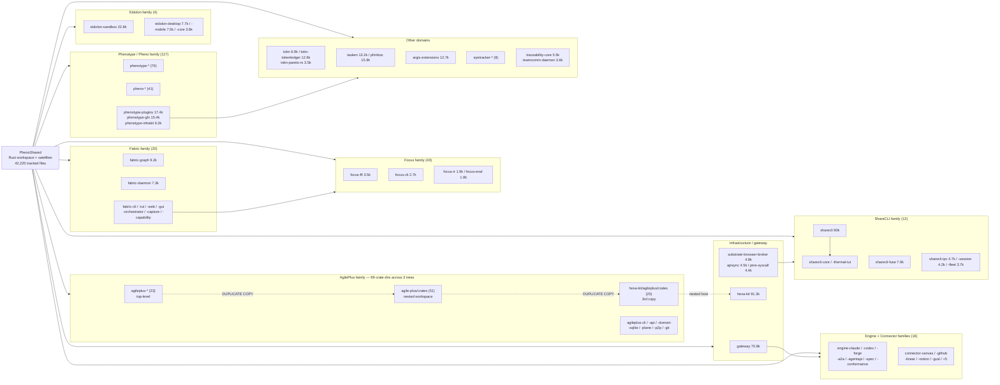

# LANE B2 — Codebase Atlas: PhenoShared

**Repo:** `/Users/kooshapari/CodeProjects/Phenotype/repos/PhenoShared`
**Branch / HEAD:** `layer/governance-happy-path-claims` @ `ad667428b` (2026-11-09)
**Working tree:** 1 modified path (not clean)
**Method:** bounded shell measurement (git ls-files, find, wc). All numbers are reproducible with the commands quoted inline.

---

## 1. Repo Shape

PhenoShared is a **Rust-workspaced monorepo with heavy multi-language satellites** — not a single Rust crate.

- Root `Cargo.toml` is a real `[workspace]` (`resolver = "2"`, explicit `members = [` list, **not** a glob). It references `crates/` **306** times.
- `crates/` holds **372** directory entries; **369** are crate-like (3 are `*.md` manifests: `ABSORPTION_MANIFEST.md`, `eidolon-PROVENANCE.md`, etc.).
- **42,225** tracked files total.
- **85** crates ship a `src/main.rs` (binary crates). **155** `[[bin]]` targets are declared across manifests — i.e. **~70 extra bin targets beyond the one-crate-one-binary baseline** (multiple bins per crate, plus example/bench bins).
- The repo is a **host for absorbed products**: `absorption/` (4,414 files), `_archived/` (632), `archive/`+`archives/` (225), `docs/absorbed-from-*`, and a vendored `.vendor/lancedb` tree.

### ⚠️ Forensic red flag: three parallel copies of the agileplus crate family

| Location | agileplus-family crate dirs |
|---|---|
| `crates/agileplus-*` (top level) | **23** |
| `crates/agile-plus/crates/` (nested workspace) | **51** |
| `crates/hexa-kit/agileplus/crates/` (nested, 3rd copy) | **25** |

This is the single highest-value structural finding for a forensic lane: **the same product family is vendored three times over at different depths**, which is why naive per-directory LOC sums (677k LOC across the top-45 crates) massively overstate the real codebase (304k tracked Rust LOC). Any "size of PhenoShared" number must be de-duplicated first.

---

## 2. Size / LOC Tables

### 2a. Headline counts

| Metric | Value |
|---|---|
| Tracked files | 42,225 |
| Tracked Rust files | 7,209 |
| Crate dirs (`crates/*`) | 372 (369 crate-like) |
| Workspace `crates/` refs in root manifest | 306 |
| Crates with `src/main.rs` | 85 |
| `[[bin]]` targets | 155 |
| First-party Rust LOC (tracked, excl. vendor/archive/node_modules) | **304,248** |
| First-party Python LOC | 720,862 |
| First-party Go LOC | 243,250 |

### 2b. First-party LOC by extension
*(tracked files only; excludes `.vendor/`, `docs/absorbed*`, `node_modules/`)*

| Ext | Files | LOC | Note |
|---|---|---|---|
| `.py` | 4,341 | 720,862 | **largest language by LOC** — Python satellites dominate |
| `.json` | 1,918 | 712,494 | inflated by data/schema payloads, not logic |
| `.rs` | 6,451 | 304,248 | **Rust is the third-largest, not the first** |
| `.yml` | 1,367 | 76,623 | CI/config heavy |
| `.sh` | 474 | 52,450 | high LOC-per-file (scripts) |
| `.toml` | 1,169 | 39,632 | manifests |
| `.md` | 10,517 | 39,219 | extremely low LOC/file — one-line docs/stubs |
| `.ts` | 467 | 30,445 | |
| `.js` | 157 | 16,339 | |
| `.tsx` | 119 | 16,149 | |
| **Code total** (rs+py+ts+tsx+go+sh+js) | **13,164** | **~1,383,743** | |
| **Config/data total** (json+yml+toml+md) | 14,971 | ~867,968 | |

### 2c. Raw tracked-file extension histogram (all files)

```
10532  md      7209  rs      5709  py      2884  ts
 2819  go      2327  tsx     1937  json     1367  yml
 1170  toml     474  sh       382  yaml      375  js
```

**Markdown outnumbers code.** 10,532 markdown files vs 7,209 Rust + 5,709 Python. Documentation density is a defining characteristic (and a maintenance surface) of this repo.

---

## 3. Language Split

| Language | Share of code LOC (rs+py+ts+tsx+go+sh+js ≈ 1.384M) |
|---|---|
| Python | ~52% |
| Rust | ~22% |
| Go | ~18% |
| TypeScript (+TSX) | ~3.4% |
| Shell | ~3.8% |
| JavaScript | ~1.2% |

**Reading:** PhenoShared's *Rust workspace* is the visible spine (13,848 of 42,225 tracked files live under `crates/`), but the *actual code mass* is Python. Any LOC comparison that only looks at `crates/` understates the repo by ~4x. The `.vendor/lancedb` Rust tree is third-party and must be excluded from every first-party metric.

---

## 4. Crate Inventory (tiered by LOC)

> **Measurement caveat:** per-crate LOC below uses `find` (includes untracked files and double-counts nested crates). It is an **upper bound**. The authoritative first-party Rust total is **304,248 LOC** from `git ls-files '*.rs'`. The top-45 `find` sum is ~677,000 — a 2.2x overcount driven by the nested duplicate trees and untracked build residue.

### Tier 1 — Mega (≥ 50k LOC upper bound) — 4 crates
| LOC | Crate | Family |
|---|---|---|
| 132,228 | `crates/agile-plus/` | AgilePlus (nested workspace of 51) |
| 91,295 | `crates/hexa-kit/` | HexaKit (contains 3rd agileplus copy) |
| 90,061 | `crates/sharecli/` | ShareCLI |
| 70,752 | `crates/gateway/` | Gateway |

These 4 alone are 53% of the top-45 `find` sum.

### Tier 2 — Large (10k–50k) — 8 crates
| LOC | Crate | Family |
|---|---|---|
| 22,828 | `crates/eidolon-sandbox/` | Eidolon |
| 17,438 | `crates/phenotype-plugins/` | Phenotype |
| 15,945 | `crates/phinbox/` | standalone |
| 15,418 | `crates/phenotype-gfx/` | Phenotype |
| 13,219 | `crates/tasken/` | standalone |
| 12,663 | `crates/argis-extensions/` | Argis |
| 12,623 | `crates/tokn-tokenledger/` | Tokn |
| 12,004 | `crates/agileplus-cli/` | AgilePlus |

### Tier 3 — Mid (5k–10k) — 14 crates
`fabric-graph` 9,188 · `sharecli-fuse` 7,879 · `eidolon-desktop` 7,702 · `eidolon-mobile` 7,549 · `fabric-daemon` 7,318 · `tokn` 6,918 · `agileplus-api` 6,762 · `phenotype-infrakit` 6,288 · `klipdot-capture` 6,034 · `agileplus-sqlite` 5,714 · `pheno-terminal` 5,640 · `eyetracker-inference` 5,605 · `traceability-core` 5,507 · `phenotype-tooling-observability` 5,420

### Tier 4 — Small (2.5k–5k) — 20 crates
`substrate-browser-broker` 4,845 · `sharecli-ipc` 4,700 · `agileplus-domain` 4,567 · `apisync` 4,520 · `pine-syscall` 4,378 · `agileplus-subcmds` 4,360 · `pheno-proc-runtime` 4,305 · `sharecli-session` 4,194 · `connector-canvas` 3,948 · `agileplus-p2p` 3,945 · `focus-cli` 3,865 · `fabric-cli` 3,854 · `agileplus-plane` 3,851 · `eidolon-core` 3,833 · `sharecli-fleet` 3,685 · `teamcomm-daemon` 3,619 · `focus-ffi` 3,546 · `agileplus-git` 3,535 · `tokn-pareto-rs` 3,451

### Tier 5 — Micro (< 2.5k) — ~324 crates
The long tail: ~87% of crates are under 2.5k LOC. The `crates/` directory is a **broad platform surface, not a set of large services**.

### Family rollup (prefix match, case-insensitive)

| Family | Crate dirs | Note |
|---|---|---|
| `pheno*` | 117 | of which `phenotype*` = **76**, `pheno-*` = 41 |
| `focus*` | 43 | largest single non-agileplus family |
| `agileplus*` | 23 | plus 51 nested + 25 in hexa-kit |
| `fabric*` | 20 | |
| `substrate*` | 15 | |
| `sharecli*` | 12 | |
| `connector*` | 9 | |
| `eyetracker*` | 8 | |
| `engine*` | 7 | engine-a2a, -agentapi, -claude, -codex, -conformance, -forge, -spec |
| `eidolon*` | 4 | |
| `tokn*` | 3 | |
| `traceability*` | 2 | |
| `argis*` | 1 | |

---

## 5. Top-Level Directory Classification

~130 top-level directories. Tracked-file counts for the top 22:

| Dir | Files | Class |
|---|---|---|
| `crates/` | 13,848 | **Core** — Rust workspace |
| `docs/` | 11,721 | **Records** — docs, ADRs, absorbed-from trees |
| `absorption/` | 4,414 | **Historical** — absorbed upstream code |
| `audits/` | 1,750 | **Records** |
| `agents/` | 1,534 | **Core** — agent definitions |
| `agileplus/` | 1,106 | **Product** |
| `_archived/` | 632 | **Historical** |
| `sites/` | 603 | **Product** — web surfaces |
| `bench/` | 391 | **Ops** |
| `scripts/` | 388 | **Ops** |
| `servers/` | 386 | **Core** — server implementations |
| `python/` | 314 | **Core** — Python satellites |
| `tests/` | 297 | **Core** — cross-repo tests |
| `infrakit/` | 265 | **Core** |
| `archives/`,`archive/` | 225 | **Historical** |
| `state/` | 193 | **State** |
| `projects/` | 178 | **Records** |
| `kitty-specs/` | 170 | **Specs** |
| `unity/` | 166 | **Product** |
| `registry/` | 147 | **Core** — registry |
| `handbook/` | 142 | **Records** |
| `.github/` | 141 | **Ops** — CI |

**Buckets:**
- **Core code:** `crates/`, `src/`, `python/`, `go-fabric/`, `rust/`, `native/`, `infrakit/`, `linux-client/`, `windows-client/`, `servers/`, `agents/`, `registry/`, `tests/`, `bindings/`, `libs/`, `kernels/`, `middleware/`, `program/`, `engine/`
- **Product surfaces:** `apps/`, `sites/`, `web/`, `gui/`, `dashboard/`, `unity/`, `pheno/`, `agileplus/`, `pheno-cli/`, `harbor_cli/`, `ports/`, `platform/`, `platforms/`
- **Records & governance:** `docs/`, `adrs/`, `architecture/`, `spec/`, `specs/`, `agileplus-specs/`, `handbook/`, `plans/`, `findings/`, `audits/`, `audit/`, `evidence/`, `attestations/`, `verification/`, `verifier/`, `worklog/`, `worklogs/`, `governance/`, `phenotype-governance/`, `grades/`, `promotion/`, `risks/`, `patterns/`, `contracts/`, `schemas/`, `tokens/`, `locales/`, `anti-patterns/`, `beads/`
- **Historical / absorbed:** `absorption/`, `_archived/`, `archive/`, `archives/`, `historical/`, `repos/`, `docs/absorbed-from-*`
- **Ops & tooling:** `scripts/`, `bench/`, `benches/`, `benchmarks/`, `harness/`, `harnesses/`, `tools/`, `tooling/`, `cli/`, `cmd/`, `bin/`, `deploy/`, `iac/`, `compose/`, `config/`, `configs/`, `hooks/`, `fuzz/`, `eval/`, `evals/`
- **State & artifacts:** `state/`, `traces/`, `datasets/`, `sbom/`, `assets/`, `target/`, `node_modules/`, `experiments/`, `playground/`
- **Templates:** `template-go/`, `template-python/`, `template-rust/`, `template-typescript/`, `templates/`, `scaffold/`

---

## 6. Binary Count

| Metric | Value |
|---|---|
| `[[bin]]` targets declared | **155** |
| Crates with `src/main.rs` | **85** |
| Implied extra bin targets (multi-bin / example / bench crates) | ~70 |

**Interpretation:** 155 binaries across 85 binary-capable crates means **multi-binary crates are common** — the workspace ships many distinct executables (CLI subcommand crates, daemon bins, example harnesses). `agileplus-cli` + `agileplus-subcmds` + `focus-cli` + `fabric-cli` + `pheno-cli` + `harbor_cli` are separate binary surfaces rather than subcommands of one CLI.

---

## 7. Ten Largest Files

### 7a. Ten largest tracked `.rs` files (raw, including vendor + archive)
| LOC | File | First-party? |
|---|---|---|
| 12,682 | `.vendor/lancedb/src/remote/table.rs` | ❌ vendored 3rd-party |
| 6,922 | `docs/absorbed-from-PhenoTooling/docs/absorbed-from-PhenoFastMCP-rust/crates/fastmcp-server/src/tests.rs` | ❌ archived copy |
| 5,884 | `.vendor/lancedb/src/table.rs` | ❌ vendored |
| 4,940 | `docs/.../fastmcp-server/src/router.rs` | ❌ archived copy |
| 4,408 | `docs/.../fastmcp-server/src/lib.rs` | ❌ archived copy |
| 3,795 | `docs/.../fastmcp-server/src/oauth.rs` | ❌ archived copy |
| 3,520 | `.vendor/lancedb/src/database/listing.rs` | ❌ vendored |
| 3,491 | `docs/.../fastmcp-cli/src/main.rs` | ❌ archived copy |
| 3,405 | `docs/.../fastmcp-server/src/docket.rs` | ❌ archived copy |
| 3,334 | `.vendor/lancedb/src/table/computed_columns.rs` | ❌ vendored |

**Nine of the ten largest Rust files are NOT first-party code.** They are either vendored (`lancedb`) or archived copies of an absorbed FastMCP-rust tree. Only `crates/focus-ffi/src/lib.rs` (3,254) is first-party.

### 7b. Ten largest first-party `.rs` files
| LOC | File |
|---|---|
| 3,254 | `crates/focus-ffi/src/lib.rs` |
| 3,080 | `crates/sharecli-thermal-tui/src/lib.rs` |
| 2,912 | `crates/sharecli/src/commands/proc.rs` |
| 2,721 | `crates/focus-cli/src/main.rs` |
| 2,640 | `crates/hexa-kit/agileplus/crates/agileplus-dashboard/src/routes.rs` |
| 2,142 | `crates/agile-plus/crates/agileplus-sqlite/src/lib.rs` |
| 2,029 | `crates/sharecli/src/commands/mod.rs` |
| 2,008 | `crates/sharecli/src/main.rs` |
| 1,939 | `crates/phenotype-plugins/pheno-plugin-sqlite/tests/sqlite_integration.rs` |
| 1,925 | `crates/focus-ir/src/lib.rs` |

**No first-party Rust file exceeds 3,254 lines.** The modularity mandate (≤500 lines / ≤350 target) is **systematically violated at the crate-root level**: `src/lib.rs` / `src/main.rs` files of 2–3.2k lines are common across `focus`, `sharecli`, `agileplus-sqlite`, and `focus-ir`. Several are the *same* logical module in different nested trees.

---

## 8. Component-Family Graph



---

## 9. Newcomer Reading Order

**Phase 0 — Orientation (30 min)**
1. `Cargo.toml` (root) — the workspace `members` list is the authoritative crate registry. Read it *first*; it tells you which of the 372 dirs are real.
2. `ABSORPTION_MANIFEST.md` (in `crates/`) and `crates/eidolon-PROVENANCE.md` — the provenance map for absorbed code.
3. `docs/` index + `adrs/` — architectural decisions (11,721 files; sample, don't read linearly).

**Phase 1 — The core spine (day 1)**
4. `crates/agile-plus/` — the largest product surface and the canonical AgilePlus implementation. Read `crates/agile-plus/crates/agileplus-sqlite/src/lib.rs` (2.1k) as the data-layer reference.
5. `crates/agile-plus/crates/agileplus-*/` — the domain/api/plane split (the 51 nested crates).
6. `crates/sharecli/` — the second major product; start at `src/main.rs` → `src/commands/mod.rs` → `src/commands/proc.rs` to learn the command dispatch shape.

**Phase 2 — Platform families (day 2)**
7. `crates/fabric-graph/`, `crates/fabric-daemon/`, `crates/fabric-cli/` — the Fabric substrate family.
8. `crates/gateway/` — cross-family request routing; read before the engine crates, because it dispatches to them.
9. `crates/engine-{claude,codex,forge,a2a,agentapi}/` — the harness adapter layer.

**Phase 3 — The long tail (selective)**
10. `crates/phenotype-plugins/`, `crates/phenotype-gfx/`, `crates/tokn-tokenledger/` — plugin platform and ledger.
11. `crates/focus-ffi/src/lib.rs` — the single largest first-party file; read as the canonical "how this repo does a big module" reference (and as a modularity anti-pattern example).
12. `crates/focus-*` (43 crates) — the largest family after pheno; treat as one product.

**Phase 4 — Non-Rust satellites (before touching production code)**
13. `python/` (314 files) + the 4,341 tracked `.py` files — the largest code mass in the repo. Locate the entrypoints (`python/`, `servers/`, `agents/`).
14. `go-fabric/`, `linux-client/`, `windows-client/`, `native/` — Go and native client surfaces.

**Phase 5 — Governance context**
15. `governance/`, `phenotype-governance/`, `audits/`, `evidence/`, `verification/` — the audit/assurance apparatus that this branch (`layer/governance-happy-path-claims`) is actively touching.

**Do NOT start in:** `absorption/`, `_archived/`, `archive(s)/`, `docs/absorbed-from-*`, `.vendor/`, `node_modules/`, `target/`, `state/`. These are ~5,000+ files of historical/vendor material that dominate raw file counts and actively mislead LOC and file-size metrics.

---

## 10. Measurement Commands (reproduction)

```bash
cd /Users/kooshapari/CodeProjects/Phenotype/repos/PhenoShared
grep -c 'crates/' Cargo.toml; ls crates | wc -l; git ls-files | wc -l
git ls-files | sed 's/.*\.//' | sort | uniq -c | sort -rn | head -12
for d in crates/*/; do l=$(find "$d" -name '*.rs' -type f -print0 | xargs -0 cat | wc -l); echo "$l $d"; done | sort -rn | head -45
git ls-files '*.rs' | xargs wc -l | sort -rn | head -15
grep -rn '^\[\[bin\]\]' --include=Cargo.toml . | wc -l
git ls-files | awk -F/ '{print $1}' | sort | uniq -c | sort -rn | head -22
```

---

## 11. Known Limitations of This Atlas

1. **Per-crate LOC is an upper bound** (`find`, not `git ls-files`): includes untracked files, nested duplicate crates, and any in-crate build residue. Discrepancy vs tracked total is **~2.2x**.
2. **Language LOC excludes `.vendor/`, `docs/absorbed*`, `node_modules/`** but *includes* nested duplicate crate trees (which are tracked). First-party Rust LOC of 304,248 therefore still contains duplicate copies.
3. **No dependency-graph analysis was performed** — the mermaid graph encodes *directory/name families*, not import edges. Family boundaries are inferred from naming prefix, which is reliable here but not authoritative.
4. **Binary identity beyond `[[bin]]` was not resolved** — 155 targets were counted from manifests; the actual built-binary set may differ.
5. **Working tree is not clean** (1 modified path) — a small amount of drift may exist between the measured tree and `ad667428b`.
