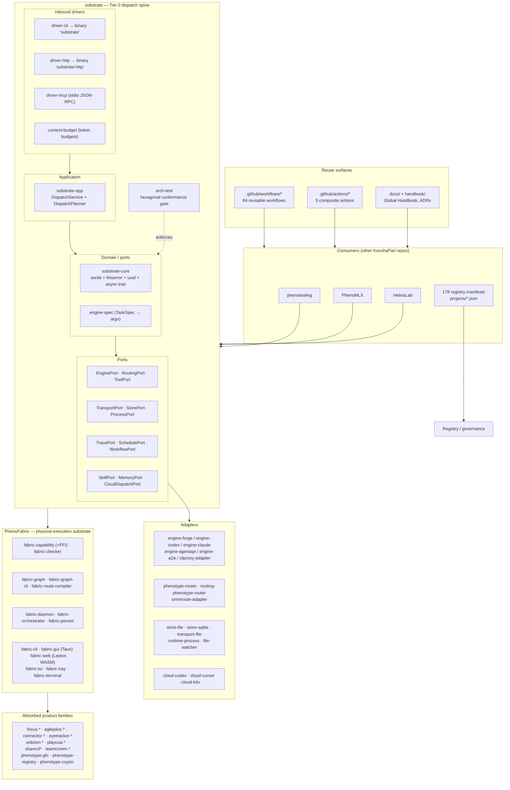

# D — Product Dossier: PhenoShared

> **Repo under analysis:** `/Users/kooshapari/CodeProjects/Phenotype/repos/PhenoShared`
> **Analysis date:** 2026-11-10
> **Method:** read-only file inspection (`head`, `ls`, `awk`, `grep`, `find`, `sed`). No builds, no writes inside the repo.
> **Evidence rule:** every claim cites a file path or a command. Anything not read is marked `UNKNOWN`.

---

## 1. Identity

| Field | Value | Evidence |
|---|---|---|
| Name | **PhenoShared** | `README.md:1`; `docs/dossiers/HANDOFF-PHENOSHARED.md` ("Former name: PhenoAI / Current name: PhenoShared") |
| Former name | **PhenoAI** | `docs/dossiers/HANDOFF-PHENOSHARED.md` §"Repository Identity" |
| Repo / canonical origin | `KooshaPari/PhenoShared`; local clones often sit at `repos/pheno`; `KooshaPari/pheno` redirects | `README.md:7-9` |
| GitHub remote | `github.com/KooshaPari/PhenoShared` | `README.md:396` (git dependency example) |
| One-liner | "Shared infrastructure workspace for the Phenotype org… a container repository, not a single-purpose project: it holds the shared Rust crates, the reusable GitHub Actions workflows and composite actions, and the shared documentation (including the Global Handbook) that the rest of the fleet consumes." | `README.md:3-6` |
| Category | **Shared infrastructure / foundation monorepo** (not a product in the user-facing sense) | `README.md:3-4`; `docs/dossiers/HANDOFF-PHENOSHARED.md` ("Role: Pooled foundation monorepo (Rust workspace + absorbed repos)") |
| Language / toolchain | Rust workspace (edition 2021, MSRV 1.80) plus companion TypeScript packages | `Cargo.toml` (`version = "0.3.10"`, `edition = "2021"`, `rust-version = "1.80"`); `PRD.md:3` |
| Workspace version | `0.3.10` | `Cargo.toml` (`[workspace.package]`) |
| License | MIT OR Apache-2.0 | `README.md:27`; `LICENSE-MIT`, `LICENSE-APACHE` |

### Maturity evidence

| Signal | Measurement | Evidence |
|---|---|---|
| Workspace size (README snapshot, 2026-09-17) | 76 root workspace packages (73 members + 3 path-dep), 16 binary targets, 329 first-level crate manifests, 26 nested Cargo workspaces | `README.md:16-22` |
| Workspace size (measured 2026-11-10) | **287** quoted entries in `members = [...]`; `exclude = [...]` has **4**; `default-members` is **absent (0)**; `ls crates` = **372** entries | `awk '/^members = \[/,/^\]/' Cargo.toml \| grep -c '"'` → 287; `awk '/^exclude = \[/,/^\]/'` → 4; `ls crates \| wc -l` → 372 |
| Prior verified build | `cargo check --workspace`: PASS, 0 errors, 47 warnings (missing docs, unused imports) at `main` @ `1056f3e8`, 2026-09-16 | `docs/dossiers/HANDOFF-PHENOSHARED.md` §"Current Compilation Status" |
| Build status **today** | **UNKNOWN** — no build was run in this lane (lane constraint: "Do not run builds") | — |
| CI surface | 84 reusable workflow files, 5 composite actions | `README.md:23-24` |
| Governance artifacts | `governance/` contains `happy-path-checklist.md`, `happy-path-precommit.sh`, `test-happy-path-allowlist.sh`, `test-happy-path-claims.sh` (no `governance/README.md` present) | `ls governance` → 4 files; `head -60 governance/README.md` → empty (file absent) |
| Registry presence | 178 project manifests under `projects/*.json` | `ls projects/*.json \| wc -l` → 178; `README.md:26` |
| Documentation volume | 2,507 Markdown files under `docs/` | `README.md:25` |
| Decision record | 82 ADRs in `docs/adr/`, 25 entries in `docs/adrs/` — plus a third tree of 10 files at repo root `adrs/` | `README.md:26`; my enumeration returned exactly 82 `docs/adr/*.md` and 25 `docs/adrs/*.md`; `ls adrs` → 10 files |

**Maturity verdict:** production-grade foundation that is *actively growing but visibly mid-consolidation*. Build health was last verified 2026-09-16; the repo has grown from 310→372 crate directories and 76→287 declared workspace members since then, and the README's own headline table still reports the older numbers (see Risk R-01).

---

## 2. Problem and positioning

**Problem statement (from `PRD.md:3`, verbatim):** "`phenotype-shared` is a Rust workspace (with companion TypeScript packages) providing domain-agnostic, reusable infrastructure primitives for the Phenotype ecosystem. Each crate is independently consumable with no inter-crate dependencies. The workspace is the canonical location for shared infrastructure so that every Phenotype service can depend on the same battle-tested primitives rather than reinventing them."

**Positioning:** the org's *shared layer* — deliberately not a product surface. Three cross-org functions are co-located in one workspace (`README.md:32-45`):

| Function | Location | Scope |
|---|---|---|
| Shared Rust crates | `crates/` | 329 first-level manifests; 76 packages in the root workspace (README's snapshot numbers) |
| Reusable workflows | `.github/workflows/` | 84 workflow files, called from other repos |
| Shared actions | `.github/actions/` | 5 composite actions |
| Shared docs | `docs/`, `handbook/` | Global Handbook, ADRs, absorption records, session artifacts |

**Why it exists (organizational rationale, `README.md:39-41`):** "The workspace consolidates infrastructure, tooling, agent frameworks, connectors, compute-mesh IaC, and ecosystem governance that previously lived across many standalone repositories." The absorption trail is recorded in `docs/ABSORPTION_INDEX.md` and `docs/absorption/` (33 per-project records).

**Two competing self-descriptions coexist** — a real positioning risk:
- `README.md:3` — "a container repository, not a single-purpose project".
- `PRD.md:3` — "a Rust workspace … providing domain-agnostic, reusable infrastructure primitives" with "no inter-crate dependencies" (which contradicts the actual substrate spine, where `substrate` depends on `substrate-core`, `substrate-app` depends on core ports, etc. — `README.md:57-70`).

**The flagship story** is the *substrate spine*: `substrate` is "the Tier 0 dispatch spine… routes a task to the best available coding engine through a deterministic planner and a set of hexagonal ports, so consumers depend on one facade instead of wiring adapters by hand" (`README.md:49-56`). The dependency direction is "enforced mechanically by `arch-test`, which fails the build when an edge crosses the domain/adapter boundary the wrong way" (`README.md:55-56`).

**Consumer-facing rationale (governance), `README.md:417-424`:** "Before adding a cross-domain dependency, check whether an existing crate in the tables above already covers it; the workspace prefers extending an adapter over a new parallel implementation." File-size budget: "Keep files under 500 lines, with 350 as the goal." Commits carry ledger trailers (`tx-agent`, `tx-validated`); history is append-only.

---

## 3. Capability map — one subsection per product family

Family prefixes are taken from `README.md:194-215` ("Crate inventory by prefix"). Counts from that table are the **README's** figures; the "measured 2026-11-10" column is my own `ls crates | sed 's/-[^-]*$//' | sort | uniq -c | sort -rn` result, which uses a different (last-hyphen-segment) grouping basis and is therefore *not* directly comparable — see R-02.

### 3.1 `substrate-*` — Tier 0 dispatch spine (README prefix count 10; measured 10)

**What it is:** the org's single facade for routing a task to the best available coding engine. Hexagonal: `substrate-core` holds domain + ports and depends only on `serde`, `thiserror`, `uuid`, `async-trait`; `substrate-app` holds the `DispatchService` use-case and `DispatchPlanner` (`README.md:59-70`).

**Key crates** (`README.md:59-131`):

| Layer | Crates |
|---|---|
| Core | `substrate` (SDK facade; features `app`, `spec`, `a2a`), `substrate-core`, `substrate-app`, `engine-spec` (provider-agnostic `TaskSpec`→argv), `arch-test` (architecture conformance tests) |
| Inbound drivers | `driver-cli` (binary `substrate`; verbs `dispatch`, `plan`, `argv`, `cloud-dispatch`, `serve`), `driver-http` (binary `substrate-http`; REST for dispatch/planning/routing + A2A mailbox), `driver-argv`, `driver-mcp` (MCP over stdio JSON-RPC bridging `EnginePort`/`RoutingPort`/`ToolPort`), `context-budget` (per-conversation token budget middleware: reject/truncate/warn) |
| Engine adapters | `engine-forge`, `engine-codex`, `engine-claude`, `engine-agentapi`, `engine-a2a`, `engine-conformance` (proves `EnginePort` stays harness-agnostic), `cliproxy-adapter` (50+ agent CLIs behind one OpenAI-compatible endpoint) |
| Routing / ports / transports | `phenotype-router` (Phenotype-owned decision layer, ADR-050/051, OTel-native spans), `routing-phenotype-router`, `omniroute-adapter`, `transport-file` (append-only JSONL mailboxes + lockfile-lease claim), `store-file`, `store-sqlite` (`MailboxStore`/`ClaimPort`/`MemoryPort`/`EventStorePort`), `runtime-process` (`ProcessPort` via `command-group`), `file-watcher`, `substrate-serve-lock` (single-instance guard) |
| Workflow / orchestration | `substrate-trace` (`TracePort`: Noop/Recording/MultiTrace/AgilePlus/Tracera), `substrate-schedule` (`SchedulePort` via `croner`), `substrate-dag` (`WorkflowPort` via `petgraph`), `substrate-skills` (`SkillPort`/`ToolRegistry`), `substrate-memory` (bounded ring buffer + two-tier compose with `store-sqlite`), `substrate-tui`, `substrate-a2a` (wire schema), `dispatch-bridge` (HTTP+SSE+Unix-socket), `phenotype-mcp`, `supervisor`, `wave` (N concurrent teammate lanes), `wave-3lane-tests`, `orchestrator` (`wave.toml` loader) |
| Cloud dispatch | `cloud-codex` (OpenAI Codex Cloud), `cloud-cursor` (Cursor Cloud Agents REST v1), `cloud-kilo`, `cloud-dispatch-conformance` |

**Entry points:** binary `substrate` (`driver-cli`), binary `substrate-http` (`driver-http`), `crates/substrate` as a Rust library.
**Status evidence:** `substrate` is the first two entries in `Cargo.toml` `members` (`Cargo.toml` members list head) and is called out as "The substrate spine" in `README.md:49`; `arch-test` enforces its boundary mechanically (`README.md:55-56`). ADR-0030 records failover as "Accepted (impl landed 2026-09-06; see crates/fabric-graph/src/failover.rs)". **Current build status: UNKNOWN (no build run).**

### 3.2 `fabric-*` — PhenoFabric execution/data/IO substrate (README prefix count 20; measured 14)

**What it is:** "Physical execution substrate: capability inventory, topology, route compilation, leases, surface isolation, and streaming" (`README.md:134-137`). README declares "PhenoFabric (22 packages)" (`README.md:131-133`) but lists 23 rows including the `phenotype-nvms-adapter` shim.

**Key crates** (`README.md:139-163`): `fabric-capability` (+ `fabric-capability-ffi` C bindings), `fabric-checker` (admission decisions), `fabric-graph` (topology + route compilation), `fabric-graph-cli` (bridges Go callers without cgo), `fabric-persist` (SQLite coordinator state), `fabric-daemon` (long-running coordinator: topology, leases, wire transport, health checks), `fabric-orchestrator`, `fabric-cli` (`fabric`: `cap`, `graph`, `route`, `workspace`), `fabric-workspace` (seat-leases), `fabric-frame-transport` (HEVC/AV1 over TCP), `fabric-surface-mojo` (Mojo FFI GPU surface), `fabric-terminal` (`tf-web`, `tf-sync`), `fabric-capture` (Windows Terminal capture agent), `fabric-tray`, `fabric-tui`, `fabric-gui` (Tauri v2), `fabric-web` (Leptos WASM SPA), `fabric-research-ledger`, `fabric-integration-tests`, `phenotype-nvms-adapter`, `fabric-full-demo`.

**Entry points:** `fabric` binary (`fabric-cli`); `fabric-daemon`; `fabric-gui` Tauri app; `fabric-web` WASM frontend.
**Status evidence:** absorbed from PhenoFabric at commit `365a3572` (997 files, 118K lines) — `docs/dossiers/HANDOFF-PHENOSHARED.md` absorption table. ADR-0001 "Define Phenotype Fabric as the execution/data/I-O substrate", ADR-0002 "One packaged product shell over modular adapters" (**Accepted**), ADR-0003 "Use a PipeWire/JACK-inspired typed node-port-link graph" (**Accepted**), ADR-0020 "Use Phenotype Fabric as a working name only" (**Accepted**), ADR-0033 "Fabric Daemon Architecture", ADR-0035 "Phenotype Fabric GUI Suite" — all in `docs/adr/`. `crates/fabric-gui/src-tauri` is **excluded** from the workspace in `Cargo.toml` with the comment that Tauri shells bind GTK/WebKit/libsoup-3.0 and cannot build on the generic Linux CI image. `crates/fabric-frame-transport/fuzz` is also excluded.

### 3.3 `pheno-*` / `phenotype-*` — the long tail of shared primitives (README: `pheno-*` 117, `phenotype-*` 75; measured 14 and 40)

**What it is:** the largest bucket, holding absorbed product families' core primitives. README's own sub-families:

| Sub-family | Packages | Key crates | Evidence |
|---|---|---|---|
| PhenoRegistry | 3 | `phenotype-project-registry`, `phenotype-service-registry` (hexagonal port + in-memory adapter), `phenotype-health` | `README.md:172-178` |
| PhenoInfra | 3 | `phenotype-crypto` (hashing, symmetric encryption, key derivation, HMAC), `phenotype-observability`, `phenotype-policy-engine` | `README.md:180-186` |
| PhenoGfx | 2 | `phenotype-gfx` (voxel, LOD, streaming, postfx, water, voxelizer, terrain — ADR-004), `phenotype-voxel` (compatibility shim) | `README.md:165-171` |
| Observability & test tooling | 3 | `pheno-otel` (pinned OTLP export surface), `fake-forge` (network-free fake forge), `fake-codex-cloud` (fake Codex Cloud endpoint) | `README.md:188-194` |

**Entry points:** library crates only.
**Status evidence:** PhenoRegistry absorbed at `f7ab4cdb` (3,848 files, 2.1M lines), PhenoInfra at `6c9b79ca`, PhenoGfx at `25c8dde1` — `docs/dossiers/HANDOFF-PHENOSHARED.md`.

### 3.4 `focus-*` — FocalPoint productivity platform (README 43; measured 31)

**What it is:** a productivity platform absorbed into the shared substrate. README: "FocalPoint productivity platform" (`README.md:198`) and "FocalPoint platform (53 crates extracted from FocalPoint)" (`README.md:224`).
**Key crates:** `crates/focus-*/` are **nested workspaces**, not root members (`README.md:219-233`).
**Entry points:** UNKNOWN — I did not list `crates/focus-*/` contents.
**Status evidence:** README explicitly separates them from the root workspace ("Not every manifest under `crates/` is a member of the root workspace. Some live in nested sub-workspaces", `README.md:216-218`).

### 3.5 `agileplus-*` — AgilePlus planning & sync (README 23; measured 19)

**What it is:** "AgilePlus planning and sync" (`README.md:199`). README's nested-workspace list calls out `crates/agile-plus/` — "AgilePlus: domain, API, gRPC, sqlite, git, NATS, P2P sync, triage, telemetry" (`README.md:222`).
**Key crates:** `crates/agile-plus/` nested workspace; `agileplus-*` root crates.
**Entry points:** UNKNOWN (not listed).
**Status evidence:** ADR-005 "AgilePlus Governance Boundary" (**Accepted**, `docs/adr/ADR-005-agileplus-governance-boundary.md`); ADR-0016 "Preserve AGSLAG, AgilePlus, thegent, Tracera, and ledger authority" (**Accepted**); ADR-012 "Plugin Architecture for AgilePlus" (**Proposed**).

### 3.6 `connector-*` — third-party service integrations (README 9; measured 9)

**What it is:** "Connector integrations (GitHub, Linear, Notion, Fitbit, Strava, GCal, Readwise)" (`README.md:200`).
**Key crates:** `crates/connector-*` (nested workspaces, part of the FocalPoint extraction — `README.md:224`).
**Status evidence:** README prefix table only.

### 3.7 `eyetracker-*` — eye tracking pipeline (README 8; measured 8)

**What it is:** "Eye tracking pipeline" (`README.md:201`). Workspace members include `crates/eyetracker-camera`, `-cli`, `-core`, `-domain`, `-ffi`, `-inference`, `-math` (`Cargo.toml` members head).
**Entry points:** binary `eyetracker-cli` (implied by the member name — the CLI wiring itself was not read).
**Status evidence:** root-workspace membership confirmed in `Cargo.toml`; `crates/eyetracker-*` also listed as a nested workspace (`README.md:233`).

### 3.8 `engine-*` — engine adapters (README 7; measured 7)

**What it is:** `EnginePort` adapters for concrete coding-engine CLIs: `engine-forge`, `engine-codex`, `engine-claude`, `engine-agentapi`, `engine-a2a`, `engine-conformance`, plus `cliproxy-adapter` (`README.md:73-83`).
**Status evidence:** `engine-conformance` "proving `EnginePort` stays harness-agnostic across adapters" (`README.md:81`).

### 3.9 `eidolon-*`, `playcua-*`, `sharecli*`, `teamcomm-*`, `pheno-compose*`, `pheno-proc-runtime`, `hexa-kit`, `argis-extensions`, `Cmdra` — absorbed runtimes & tools

| Family | What it is | Evidence |
|---|---|---|
| `eidolon-*` (4) | "Eidolon cross-platform surfaces"; Eidolon absorbed as an "Agent runtime" | `README.md:202`; `docs/dossiers/HANDOFF-PHENOSHARED.md` absorption table (`5f0ffd08`, Eidolon) |
| `playcua-*` (2) | "PlayCua computer-use ports"; PlayCua absorbed as "Computer-use agent" | `README.md:203`; handoff absorption table (`8fdd395d`, PlayCua) |
| `sharecli*` | "process/IO/syscall hypervisor with FUSE, mesh, fleet, and tray tiers" | `README.md:225`; ADR-0015 "Keep ShareCLI standalone and integrate it as a privileged runtime client" (**Accepted**) |
| `teamcomm-*` | "inter-agent coordination protocol, daemon, MCP server" | `README.md:226` |
| `pheno-compose-*` (measured 3 + 6) | "PhenoCompose port traits, adapters, CLI" | `README.md:224`; ADR-ECO-021 "PhenoCompose dead `cuda` feature flag removal" (**Accepted**) |
| `pheno-proc-runtime` | "process runtime with queue and dedup fuzz targets" | `README.md:227` |
| `hexa-kit`, `argis-extensions`, `Cmdra` | standalone absorbed trees | `README.md:232-233` |

### 3.10 `store-*` / `cloud-*` / `driver-*` — port backends and adapters

`store-*` (2) = SQLite/file store backends for the substrate; `cloud-*` (4) = `cloud-codex`, `cloud-cursor`, `cloud-kilo`, `cloud-dispatch-conformance`; `driver-*` (4) = substrate inbound drivers (`README.md:196-206`, `README.md:73-79`).

### 3.11 Non-Rust surfaces

`apps/` → `bench-cockpit`, `byteport`, `desktop`, `phinbox-app`, `tooling`; `platform/` → `federation`; `servers/` → `external`, `forge3-bridge`, `pheno-org`, `substrate`; `serving/` → `serve.sh`, `tb2-30100-vllm.service` (`ls apps platform servers serving`). Evidence for the *contents* of each of these directories: **UNKNOWN** (not read).

---

## 4. Architecture layers

### 4.1 The declared layering

`README.md:49-56` states the architecture is **hexagonal (ports & adapters)**, enforced by the `arch-test` crate, which "fails the build when an edge crosses the domain/adapter boundary the wrong way."

- **Domain / core:** `substrate-core` — "Hexagonal core contracts (domain + ports). Depends only on `serde`, `thiserror`, `uuid`, `async-trait`." (`README.md:62-63`)
- **Application:** `substrate-app` — "the `DispatchService` use-case and `DispatchPlanner`, generic over the core ports." (`README.md:64-65`)
- **Ports:** `EnginePort`, `RoutingPort`, `ToolPort`, `TransportPort`, `StorePort`, `ProcessPort`, `WatcherPort`, `TracePort`, `SchedulePort`, `WorkflowPort`, `SkillPort`, `MemoryPort`, `CloudDispatchPort`, `ClaimPort`, `MailboxStore`, `EventStorePort` (`README.md:73-131`).
- **Adapters:** the `engine-*`, `routing-*`, `omniroute-adapter`, `cliproxy-adapter`, `store-*`, `transport-file`, `runtime-process`, `file-watcher`, `cloud-*` families.
- **Inbound drivers:** `driver-cli`, `driver-http`, `driver-mcp` — the composition roots.
- **Facade:** `substrate` — "SDK facade: re-exports ports, domain types, planner, optional adapters. Features `app`, `spec`, `a2a`." (`README.md:61`)

### 4.2 The PhenoFabric layering (parallel plane)

`docs/architecture/` contains 20 top-level entries: `api.md`, `control-plane.md`, `files-clipboard.md`, `graph-runtime.md`, `input.md`, `network-lan-wan.md`, `object-plane.md`, `openapi.yaml`, `platform-linux.md`, `platform-macos.md`, `platform-windows.md`, `protocols.md`, `README.md`, `realtime-audio.md`, `route-compiler.md`, `scheduler.md`, `schemas`, `security.md`, `spec-024-025-wire-mapping.md`, `state-machines.md` (evidence: `ls architecture`). `docs/ARCHITECTURE_LAYERS.md` and `docs/ARCHITECTURE.md` also exist (`ls docs`). ADR-0022 "Keep coordinator off payload and RT hot paths" (**Accepted**) and ADR-0023 "Capability Inventory — Signed Descriptor Schema and FFI" (**Accepted**) describe the Fabric control-plane split; ADR-0024 maps `odin.nvms` onto Fabric `CapabilityDescriptor`.

### 4.3 Diagram



**Diagram caveat:** the edges `Spine --> Fabric` and `Fabric --> Absorbed` are *narrative* (README describes Fabric as the "execution/data/I-O substrate" that substrate dispatches into), **not** measured Cargo dependency edges — I did not run `cargo metadata` to dump the real dependency graph. Directionality of the real graph is UNKNOWN.

---

## 5. Consumers / dependents

### 5.1 Documented consumers (evidence-backed)

| Consumer | How it depends | Evidence |
|---|---|---|
| **phenotooling** | "Repositories that consume these crates, workflows, or docs include phenotooling, PhenoMLX, HeliosLab, and other KooshaPari org repos." | `README.md:411-414` |
| **PhenoMLX** | same sentence; also a prior absorption source (`7a8ef302`, 587 files, 81K lines) | `README.md:411-414`; `docs/dossiers/HANDOFF-PHENOSHARED.md` |
| **HeliosLab** | same sentence | `README.md:411-414` |
| **Any repo** (crates) | `git = "https://github.com/KooshaPari/PhenoShared"`, `package = "phenotype-mcp"`; or `path = "../PhenoShared/crates/phenotype-mcp"` | `README.md:388-402` |
| **Any repo** (CI) | `uses: KooshaPari/PhenoShared/.github/workflows/ci.yml@main` | `README.md:405-409` |

### 5.2 Internal dependents (evidence-backed)

`docs/ABSORPTION_INDEX.md` records prior consumers that were absorbed *into* this repo, not dependents of it — **do not conflate**. The index shows PhenoShared as the *owner* repo for the sprawl-consolidation wave (`Owner repo: **PhenoShared (phenoAI)**`, `docs/ABSORPTION_INDEX.md`, wave 2026-09-27) and the vendored-off-Go-tool wave (2026-10-29).

### 5.3 Registry-level dependents

178 project manifests under `projects/*.json` (`ls projects/*.json | wc -l` → 178; `README.md:26`). These include `agent-platform.json`, `AgilePlus.json`, `agentapi-plusplus.json`, `AuthKit.json`, `Authvault.json`, `Benchora.json`, `Apisync.json`, `asset-engine.json`, `AgilePlus-spec-harmonizer.json` (`ls projects | head -15`). The manifest schema itself was not read — the dependency semantics of these entries are **UNKNOWN**.

### 5.4 Downstream ecosystem authority

ADR-0016 "Preserve AGSLAG, AgilePlus, thegent, Tracera, and ledger authority" (**Accepted**) and ADR-0005 "AgilePlus Governance Boundary" (**Accepted**) imply the ecosystem treats other repos as authorities PhenoShared must not encroach on (`docs/adr/`).

### 5.5 Dependents: UNKNOWN where not evidenced

- Which *specific* other repos consume the 84 reusable workflows vs. only the crates: **UNKNOWN** (README says "and other KooshaPari org repos" without enumerating).
- Whether any consumer pins a **tag** vs `@main`: **UNKNOWN**.
- Reverse-dependency count from crates.io or from org-wide `cargo metadata`: **UNKNOWN** (not measured; would require scanning sibling repos).

---

## 6. ADR summary table

Three parallel ADR trees exist. **Numbers below are from my enumeration of `docs/adr/*.md` (82 files) and `docs/adrs/*.md` (25 entries), cross-checked against `README.md:26`.** Status is the literal `Status:` line found in the first 20 lines of each file; `—` means the file's first 20 lines contained no `Status:` line (not "unaccepted").

### 6.1 `docs/adr/` — 82 files (primary tree)

| id | title | status |
|---|---|---|
| 0001 | Define Phenotype Fabric as the execution/data/I-O substrate | — |
| 0001 | Gateway polyglot language strategy | — |
| 0001 | Hybrid Compute Mesh (7 nodes) | — |
| 0001 | Record Architecture Decisions | — |
| 0002 | Hexagonal ports/adapters architecture | — |
| 0002 | OCI Ampere as Primary Backbone | — |
| 0002 | One packaged product shell over modular adapters | **Accepted** |
| 0003 | Canonical Error type in substrate-core | — |
| 0003 | Home Desktop as Heavy Runner | — |
| 0003 | Use a PipeWire/JACK-inspired typed node-port-link graph | **Accepted** |
| 0004 | Atomic claim/lease for the single-instance guard | — |
| 0004 | Search locality tiers before remote transports | **Accepted** |
| 0004 | Tailscale as Control Plane | — |
| 0005 | Permit atomic placement but execute fused regions by default | **Accepted** |
| 0005 | Forgejo + Woodpecker vs. Gitea vs. GitHub Actions | — |
| 0005 | SQLite as the default store (rusqlite, bundled) | — |
| 0006 | Keep compute, data, I/O, resource, and product graphs as projections | **Accepted** |
| 0006 | Structured tracing via a `TracePort` | — |
| 0006 | Vaultwarden as Canonical Credential Store | — |
| 0007 | Do not introduce a universal database or ontology | **Accepted** |
| 0007 | Runner Label Routing | — |
| 0008 | Parsec Gaming-Mode Pause | — |
| 0008 | Protect local real-time islands before distributing critical loops | **Accepted** |
| 0009 | HW Mesh Agent Bus (Phase 2) | — |
| 0009 | Prefer shared memory and device DMA before compression | **Accepted** |
| 001 | Task Runner Selection and Standardization | **Accepted** |
| 0010 | No-Idle Parallelism Policy | — |
| 0010 | Prefer semantic application remoting before pixel proxies | **Accepted** |
| 0011 | Use a mobility hierarchy instead of one process-migration claim | **Accepted** |
| 0012 | Use leases and fencing tokens for exclusive focus and routes | **Accepted** |
| 0013 | Treat input, audio, video, and device clocks independently | **Accepted** |
| 0014 | Make color and HDR intent authoritative graph metadata | **Accepted** |
| 0015 | Keep ShareCLI standalone and integrate it as a privileged runtime client | **Accepted** |
| 0016 | Preserve AGSLAG, AgilePlus, thegent, Tracera, and ledger authority | **Accepted** |
| 0017 | Agents may publish and request attention but not steal focus | **Accepted** |
| 0018 | Maintain an independent out-of-band recovery plane | **Accepted** |
| 0019 | Use mutual identity and narrow privileged helpers | **Accepted** |
| 002 | Registry Adapter Architecture | **Accepted** |
| 0020 | Use Phenotype Fabric as a working name only | **Accepted** |
| 0021 | Prefer immutable objects and explicit mutable authority | **Accepted** |
| 0022 | Keep coordinator off payload and RT hot paths | **Accepted** |
| 0023 | Capability Inventory — Signed Descriptor Schema and FFI | **Accepted** |
| 0024 | NVMS Adapter — Mapping `odin.nvms` to Fabric `CapabilityDescriptor` | **Accepted** |
| 0025 | Route and Lease Semantic Model | — |
| 0026 | Workspace Persistence File Format | — |
| 0027 | Checker Decision Taxonomy & Reason Codes | — |
| 0028 | Testdata Verification Pattern | — |
| 0029 | Rust vs Go Port Policy | — |
| 0030 | Route Failover Model (PF-WP-021, R1) | **Accepted** (impl landed 2026-09-06) |
| 0031 | Trust-Root Model for Descriptor Signatures (PF-WP-016, R1) | **Accepted** (impl `crates/fabric-capability/src/trust_root.rs`) |
| 0032 | Multi-Hop Route Compiler | — |
| 0033 | Fabric Daemon Architecture | — |
| 0034 | SQLite-Backed Persistent State | — |
| 0035 | Phenotype Fabric GUI Suite | — |
| ADR-001 | Hybrid Compute Mesh (7 nodes) | — |
| ADR-001 | Optimal Language Selection for NanoVMS | **Proposed** |
| ADR-001 | Architecture Foundation and Core Principles | **Accepted** |
| ADR-002 | Polyglot Architecture (Go + Rust FFI) | — |
| ADR-002 | Three-Tier Isolation Architecture | **Proposed** |
| ADR-002 | Data Storage and Persistence Strategy | **Accepted** |
| ADR-003 | WASM Runtime Selection | — |
| ADR-003 | API Design Standards and Versioning Strategy | **Accepted** |
| ADR-004 | Absorption Staging vs Canonical Owner | **Accepted** |
| ADR-004 | Storage Architecture | — |
| ADR-004 | Authentication and Authorization Architecture | **Accepted** |
| ADR-005 | AgilePlus Governance Boundary | **Accepted** |
| ADR-005 | Networking Architecture | — |
| ADR-005 | Deployment Pipeline and Infrastructure Strategy | **Accepted** |
| ADR-006 | CLI Design | — |
| ADR-006 | Zero-Loop Agent Session Contract | **Accepted** |
| ADR-007 | Absorption Eligibility — Boundary & Scope Filters | **Accepted** |
| ADR-007 | Testing Strategy | — |
| ADR-008 | Deployment Strategy | — |
| ADR-009 | Performance Targets | — |
| ADR-010 | Security Model | — |
| ADR-011 | Observability Stack | — |
| ADR-012 | Multi-Tenancy Architecture | — |
| ADR-012 | Plugin Architecture for AgilePlus | **Proposed** |
| ADR-013 | Game Automation Automation Testing Architecture | — |
| ADR-014 | Agent Desktop Environments & Computer Use | — |
| ADR-015 | Phenotype Crate Organization & PR Guidelines | — |
| — | Architecture Decision Records - Architecture (`ARCHITECTURE.md`) | — |

### 6.2 `docs/adrs/` — 25 entries (24 ADRs + `README.md`)

| id | title | status |
|---|---|---|
| 0001 | Current-State Audit | — |
| 0002 | Risks Register (`RISKS.md`) | — |
| 0003 | Local Serving Bootstrap | — |
| 0004 | Stale-SKU Retrospective | — |
| 0005 | Locked Baseline and March-2026 Cutoff | — |
| 0006 | `pheno-serve-dev` bootstrap (2026-07-04) | — |
| 0007 | Current local serving contract | **accepted** |
| ECO-001 | Tiered MoE Expert Staging on 3090 Ti (24 GB) | — |
| ECO-001 | stashly → ResilienceKit | — |
| ECO-006 | Retire plan v1 monorepo absorption | — |
| ECO-007 | Gateway merge superset boundaries | — |
| ECO-012 | Zero-shot scorecard thresholds | — |
| ECO-013 | phenotype-registry as integration meta-repo | — |
| ECO-014 | **Decompose phenoShared — no generic consolidation repo** | — |
| ECO-014 | phenotype-gateway domain charter | — |
| ECO-015 | Hybrid gateway — app layer, Go planes, desktop convergence | — |
| ECO-016 | phenotype-omlx platform/engine split (G18) | — |
| ECO-017 | Substrate schema conventions — tier + port/adapter naming | **Accepted** (2026-06-20) |
| ECO-018 | phenotype-infra path-dep hygiene | **Accepted** (2026-06-23) |
| ECO-019 | nanovms sandbox hardening | **Accepted** (2026-06-23) |
| ECO-020 | BytePort hygiene pass | **Accepted** (2026-06-23) |
| ECO-021 | PhenoCompose dead `cuda` feature flag removal | **Accepted** (2026-06-23) |
| ECO-022 | Compute/Infra subtree — registry status correction | **Accepted** (2026-06-23) |
| ECO-023 | SDK Consolidation Decision | **Accepted** (proposed 2026-06-25) |

### 6.3 Repo-root `adrs/` — 10 files (third tree, unindexed)

`001-hexagonal-architecture.md`, `002-nats-jetstream.md`, `002-technology-stack.md`, `003-data-storage.md`, `003-property-based-testing.md`, `004-api-design.md`, `005-auth-strategy.md`, `006-deployment.md`, `007-monitoring.md`, `008-security.md` (evidence: `ls adrs`). **Titles/statuses: UNKNOWN** (not read). Note the intra-tree numbering collisions (`002-` twice, `003-` twice) and the topical overlap with `docs/adr/ADR-002.md` (Data Storage and Persistence Strategy) and `docs/adr/ADR-003.md` (API Design Standards).

### 6.4 Structural observation

`docs/adr/` alone contains **four separate `0001` records and four `0002` records** (facing different subsystems), and `docs/adrs/` contains **two `ADR-ECO-001` and two `ADR-ECO-014` records**. ADR numbering is **not globally unique** in this repository. This is a material governance risk (R-04).

---

## 7. Delivery surfaces

| Surface | Form | Evidence |
|---|---|---|
| Rust library crates | 287 declared workspace members, 372 directories under `crates/`, 26 nested Cargo workspaces | `Cargo.toml` members/exclude; `ls crates \| wc -l`; `README.md:219-233` |
| Rust binaries | 16 binary targets in the root workspace (README snapshot) | `README.md:17` |
| CLI dispatch surface | binary `substrate` (verbs `dispatch`, `plan`, `argv`, `cloud-dispatch`, `serve`) | `README.md:70` |
| HTTP/REST surface | binary `substrate-http` — dispatch, planning, routing, A2A mailbox | `README.md:71` |
| MCP surface | `driver-mcp` (stdio JSON-RPC) and `phenotype-mcp` (MCP integration adapter for substrate routing/dispatch) | `README.md:72`, `README.md:118` |
| A2A surface | `substrate-a2a` wire schema + `dispatch-bridge` (HTTP+SSE+Unix socket) + `engine-a2a` | `README.md:115-117`, `README.md:79` |
| TUI surfaces | `substrate-tui`, `fabric-tui`, `orchestrator` (`wave.toml` loader) | `README.md:113`, `README.md:160`, `README.md:124` |
| GUI surfaces | `fabric-gui` (Tauri v2 desktop shell) | `README.md:159` |
| Web surface | `fabric-web` (Leptos WASM single-page frontend) | `README.md:161` |
| Tray surface | `fabric-tray` (system tray app: daemon lifecycle, quick actions, status) | `README.md:157` |
| Daemon surface | `fabric-daemon` (long-running coordinator) | `README.md:145` |
| `apps/` trees | `bench-cockpit`, `byteport`, `desktop`, `phinbox-app`, `tooling` | `ls apps` |
| `platform/` tree | `federation` | `ls platform` |
| `servers/` trees | `external`, `forge3-bridge`, `pheno-org`, `substrate` | `ls servers` |
| `serving/` trees | `serve.sh`, `tb2-30100-vllm.service` | `ls serving` |
| Reusable GitHub Actions workflows | 84 files in `.github/workflows/` — consumed as `KooshaPari/PhenoShared/.github/workflows/ci.yml@main` | `README.md:23`, `README.md:405-409` |
| Composite Actions | 5 in `.github/actions/` | `README.md:24` |
| Docs-as-product | Global Handbook (`docs/GLOBAL_HANDBOOK.md`), `llms.txt` (machine-readable repo orientation), `SECURITY.md` | `README.md:357`, `README.md:356`, `README.md:355` |
| Release/versioning | Workspace version `0.3.10`; `docs/roadmap/release-notes.md` | `Cargo.toml`; `ls docs/roadmap` → `index.md`, `release-notes.md` |
| Build entry points | `make check` or Cargo commands; `Taskfile.yml`'s `ci` task is **broken** (calls missing `./scripts/ci-local.sh`) | `README.md:379-381` |

---

## 8. Risk register — top 10

| # | Risk | Evidence | Severity | Mitigation state |
|---|---|---|---|---|
| **R-01** | **README headline metrics are stale and internally inconsistent with the tree.** README claims 76 root workspace packages / 73 members + 3 path-dep; the actual `members = [...]` array holds **287** entries. README claims 329 first-level crate manifests; `ls crates` returns **372**. README's own measurement date is 2026-09-17. | `README.md:16-22` vs `awk '/^members = \[/,/^\]/' Cargo.toml \| grep -c '"'` → 287 and `ls crates \| wc -l` → 372 | **High** — a reader sizing the repo from the README is off by ~3.8× on crates and ~3.8× on members | Not addressed in-tree |
| **R-02** | **No single canonical crate inventory.** Three incompatible groupings exist: README prefix table (`pheno-*` 117, `phenotype-*` 75, `focus-*` 43), my last-hyphen-segment count (`phenotype` 40, `focus` 31, `pheno` 14), and the workspace `members` list. | `README.md:194-215`; my `ls crates \| sed 's/-[^-]*$//' \| sort \| uniq -c` output | **High** — "how many crates are there" has no authoritative answer | Not addressed |
| **R-03** | **Build health unverified since 2026-09-16** while the tree grew materially (310→372 crate dirs, 76→287 declared members). The last known state was PASS with **47 warnings** (missing docs, unused imports/structs). | `docs/dossiers/HANDOFF-PHENOSHARED.md` §"Current Compilation Status" (`main` @ `1056f3e8`) | **High** | Not addressed — no build was run in this lane |
| **R-04** | **ADR numbering is not unique.** `docs/adr/` holds four `0001` and four `0002` records; `docs/adrs/` holds two `ADR-ECO-001` and two `ADR-ECO-014` records; a third tree at repo-root `adrs/` collides again (`002-`×2, `003-×2`). Decisions cannot be cited unambiguously. | my enumeration of `docs/adr/` (82), `docs/adrs/` (25), `ls adrs` (10) | **High** — breaks the "immutable ledger" traceability claim | Not addressed |
| **R-05** | **Root-level documentation carries wrong-project identity.** README's own debt table flags `ARCHITECTURE.md` (phenotype-omlx), `AGENTS.md` (phenotype-omlx), `CHARTER.md` (phendocs), `PRD.md` (phenotype-shared), `SPINE.md` (phenoDesign), `docs/architecture.md` (Pine), `SECURITY.md` (phenotype-shared-temp), `INDEX.md` (Fabric), `CONTRIBUTING.md` (Fabric), plus **128 root-level `.md` files** of mixed provenance. An agent that trusts root docs inherits another product's contract. | `README.md:358-375` | **High** — this is an *agent-facing* poisoning vector, and `AGENTS.md`/`PRD.md` are exactly the files a coding agent reads first | Self-documented by README; unresolved |
| **R-06** | **Three mutually inconsistent "what is this repo" statements.** `README.md:3` = "container repository, not a single-purpose project"; `PRD.md:3` = "domain-agnostic primitives, each crate independently consumable with no inter-crate dependencies" (contradicted by the substrate spine's internal dependency chain); `docs/dossiers/HANDOFF-PHENOSHARED.md` = "Pooled foundation monorepo". | `README.md:3`; `PRD.md:3`; `README.md:57-70`; handoff §"Repository Identity" | **Medium-High** — a consumer cannot determine the supported dependency model | Not addressed |
| **R-07** | **CI entry point is broken.** `Taskfile.yml`'s `ci` task invokes `./scripts/ci-local.sh`, which is not present in the tree; the documented workaround is to use `make check` or raw Cargo commands instead. | `README.md:379-381` | **Medium** — a broken default path for local CI | Documented workaround only |
| **R-08** | **Workspace metadata points at a stale origin.** `[workspace.package] repository` in `Cargo.toml` still references a stale origin URL rather than `github.com/KooshaPari/PhenoShared` — so published crates carry a wrong homepage. | `README.md:382-383` | **Medium** — affects crate metadata and `cargo` consumers | Not addressed |
| **R-09** | **Platform-specific code is excluded from the workspace**, so it is not covered by the root build: `crates/fabric-gui/src-tauri` (Tauri binds GTK/WebKit/libsoup-3.0, cannot build on generic Linux CI), `crates/fabric-frame-transport/fuzz`, `crates/forge_daemon`, and `absorption/PhenoMLX-temp/.../src-tauri`. | `Cargo.toml` `exclude = [...]` with the explanatory comment | **Medium** — the GUI shell and the fuzzer escape the main CI gate; a `crates/forge_daemon` failure would be invisible to the root build | Documented in `Cargo.toml` comment; no alternative gate visible |
| **R-10** | **Absorption/decomposition tension.** `docs/ABSORPTION_INDEX.md` records a sprawl-consolidation wave (2026-09-27) that absorbed five repos into `absorption/<repo>/` "Source left unarchived pending operator confirmation", while `docs/adrs/ADR-ECO-014-phenoshared-decompose.md` is titled "Decompose phenoShared — no generic consolidation repo" — i.e. a decision line arguing *against* being a generic consolidation repo, sitting inside the repo that is one. `absorption/PhenoMLX-temp` is ~646 MB per the index note and its `.cargo-target/` was excluded. | `docs/ABSORPTION_INDEX.md` (sprawl wave table, vendored-off-Go wave 2026-10-29) and `docs/adrs/ADR-ECO-014-phenoshared-decompose.md` | **Medium** — unclear canonical ownership, plus disk cost inside the repo | Partially handled (`.cargo-target/` excluded) |

**Runner-up (not in top 10, noted for completeness):** `docs/adr/0005-forgejo-woodpecker-vs-gitea-vs-gh-actions.md` and `0002-oci-primary-backbone.md` / `0004-tailscale-as-control-plane.md` / `0003-home-desktop-as-heavy-runner.md` have no `Status:` line in their first 20 lines, so a large share of the primary ADR tree has **no machine-readable decision status** (35 of 82 files returned `—` in my extraction). Whether those are superseded, draft, or accepted is **UNKNOWN**.

---

## 9. Honest unknowns

Each item is genuinely unknown because it was not read or measured in this lane.

1. **Current build/test status.** No `cargo check`, `cargo test`, or `make check` was run (lane constraint). The only compilation evidence is 2026-09-16: PASS, 0 errors, 47 warnings. Everything since is unverified.
2. **True package count.** I counted 287 *quoted path entries* in `members = [...]` but did **not** run `cargo metadata --no-deps`, so I cannot say how many of those resolve to real, buildable packages (some members may be path-only stubs or fail to resolve). README's claim of 76 is *not* confirmed by my measurement.
3. **Real dependency graph and layering.** The mermaid diagram's edges between spine / Fabric / absorbed families are narrative, not measured. Actual `cargo tree` direction between families: **UNKNOWN**.
4. **Contents of `apps/`, `platform/`, `servers/`, `serving/`, `crates/focus-*/`, `crates/connector-*/`, `crates/agile-plus/`, `crates/sharecli*/`, `crates/teamcomm-*/`.** Only the directory names were listed.
5. **Semantics of the 178 `projects/*.json` manifests.** Schema not read; whether they encode dependencies, ownership, or health is **UNKNOWN**.
6. **Identity of the `adrs/` root tree.** The 10 root ADR files were listed but not read; their relationship to `docs/adr/` is **UNKNOWN**.
7. **The `docs/adrs/` `RISKS.md` (ADR 0002) and `docs/adrs/README.md`** — not read; they may define the canonical ADR taxonomy that resolves R-04.
8. **CI status of the 84 reusable workflows.** Whether each is green, and which are actively referenced, is **UNKNOWN** (no `gh` inspection performed).
9. **Which repos actually consume the workflows vs. only the crates.** README says "and other KooshaPari org repos" without enumeration.
10. **`docs/roadmap/index.md` and `docs/roadmap/release-notes.md`** were listed but not read; the milestone dates in §10 are inferred from other files, not from the roadmap index.
11. **The `serving/tb2-30100-vllm.service` and `serving/serve.sh`** — local-model serving for a 3090 Ti appears in ADR-ECO-001 ("Tiered MoE Expert Staging on 3090 Ti"), but the binding relationship to `serving/` is **UNKNOWN**.
12. **`architecture/openapi.yaml` and `architecture/schemas`** — the external API contract was not read; whether it matches `substrate-http` is **UNKNOWN**.
13. **Whether the `Governance` surface is live.** `governance/` has 4 files including `happy-path-precommit.sh` and two `test-happy-path-*.sh` scripts; whether they are wired into the pre-commit hook or CI is **UNKNOWN**.
14. **Repo hygiene beyond the 128 flagged root `.md` files** — I did not list all root files, so additional stale artifacts may exist beyond what `README.md:374` reports.

---

## 10. Milestones inferred from evidence

All dates are read from files; where a milestone is inferred rather than stated, that is marked *(inferred)*.

| Date | Milestone | Evidence |
|---|---|---|
| 2026-06-18 | **Wave G19 registry absorption** — phenotype-hub absorbed (canonical owner = this repo); vibeproxy-monitoring-unified retired to cliproxyapi-plusplus. | `docs/ABSORPTION_INDEX.md` §"Wave G19 (2026-06-18)" |
| 2026-06-20 | **Substrate schema conventions** established (tier + port/adapter naming) — ADR-ECO-017 **Accepted**. | `docs/adrs/ADR-ECO-017-substrate-schema-conventions.md` |
| 2026-06-23 | **Repo-hygiene + hardening wave** — path-dep hygiene (ADR-ECO-018), nanovms sandbox hardening (ADR-ECO-019), BytePort hygiene (ADR-ECO-020), dead `cuda` flag removal (ADR-ECO-021), registry status correction (ADR-ECO-022) — all **Accepted** the same day. | `docs/adrs/ADR-ECO-018` … `ADR-ECO-022` |
| 2026-06-25 | **SDK Consolidation** — ADR-ECO-023 **Accepted** (proposed 2026-06-25). | `docs/adrs/ADR-ECO-023-sdk-consolidation.md` |
| 2026-07-04 | **Local-model serving bootstrap** — ADR-ECO-006 `pheno-serve-dev` bootstrap. | `docs/adrs/0006-pheno-serve-dev-bootstrap.md` |
| *(undated)* | **Absorption of 9 prior repos into the workspace** — PlayCua `8fdd395d`, Eidolon `5f0ffd08`, Gateway `eebd434b`, PhenoFabric `365a3572` (997 files / 118K lines), PhenoInfra `6c9b79ca`, PhenoLab `a2437820` (1,553 files / 510K lines), PhenoGfx `25c8dde1`, PhenoRegistry `f7ab4cdb` (3,848 files / 2.1M lines), PhenoMLX `7a8ef302` (587 files / 81K lines). *(inferred: commits predate the 2026-09-16 handoff)* | `docs/dossiers/HANDOFF-PHENOSHARED.md` absorption table |
| 2026-09-06 | **Route failover implementation landed** — ADR-0030 **Accepted** "impl landed 2026-09-06; see crates/fabric-graph/src/failover.rs". | `docs/adr/0030-route-failover-model.md` |
| 2026-09-16 | **Verified-good handoff snapshot** — `main` @ `1056f3e8`; `cargo check --workspace` PASS (0 errors, 47 warnings); 76 workspace members; 310 crate dirs; 9 absorption commits applied; fixes in `0066e38b`. | `docs/dossiers/HANDOFF-PHENOSHARED.md` |
| 2026-09-17 | **README "At a glance" metrics measured** (76 packages / 329 manifests / 84 workflows / 2,507 docs / 82+25 ADRs / 178 manifests) — the README's freshness anchor. | `README.md:16-26` |
| 2026-09-27 | **Sprawl consolidation wave** — 5 standalone repos absorbed as plain copies under `absorption/<repo>/` with `PROVENANCE.md` each: phenotype-canonicalization (SPR-01), phenotype-cvp-audit-2026-09-14 (SPR-02), phenoDesign-visual-production-v2 (SPR-03), PhenoMLX-temp (SPR-04, ~646 MB), PhenoInfra (SPR-05). All marked "Source left unarchived pending operator confirmation". | `docs/ABSORPTION_INDEX.md` §"Sprawl consolidation wave (2026-09-27)" |
| 2026-10-29 | **Vendored-off-Go-tool disposition wave** — a Go tool absorbed outside the `absorption/` flow recorded so the tree is permanently excluded from CI and future module sweeps. | `docs/ABSORPTION_INDEX.md` §"Vendored-off-Go-tool disposition wave (2026-10-29)" |
| 2026-11-09/10 | **Current observation point** — 287 declared workspace members, 372 `crates/` entries, 82 + 25 + 10 ADRs across three trees, 178 registry manifests, 3 ADR trees with colliding numbering. | measurements in §1, §6 of this dossier |
| *(future, no date)* | **Roadmap Horizons 1-5** — H1 measured local fabric; H2 cross-device creator/gaming fabric; H3 agent and explicit compute fabric; H4 seamless surfaces and WAN; H5 adaptive and atomic research. Each horizon carries a stated *Proof* condition (e.g. H1: "one keyboard/mouse/audio/display workflow across host and disjoint VMs with no stuck state and no unnecessary encoded same-host path"). | `ROADMAP.md:1-55` |

**Product roadmap horizon — no dates** (`ROADMAP.md`): all five horizons are outcome-defined with *Proof* statements and **no calendar dates and no fabricated durations**, which is a deliberate and consistent with the repo's "outcome-based milestones" style.

---

### Method note / reproducibility

Commands executed (all read-only, all rooted at the repo path; no recursive search over `$HOME`):
```
head -100 README.md; ls docs | head -45; ls adrs | head -20; ls architecture | head -20
ls crates | sed 's/-[^-]*$//' | sort | uniq -c | sort -rn | head -25; ls crates | wc -l
ls apps platform servers serving | head -30
head -60 governance/README.md; ls governance | head -25
find . -maxdepth 2 \( -iname 'ROADMAP*' -o -iname 'PRD*' -o -iname 'DOSSIER*' \)
for d in docs/adr docs/adrs; do for f in $d/*.md; do head -5 | head -20; done; done
head -55 PRD.md; head -55 ROADMAP.md
awk '/^members = \[/,/^\]/' Cargo.toml | grep -c '"'   # 287
awk '/^exclude = \[/,/^\]/' Cargo.toml | grep -c '"'   # 4
ls projects/*.json | wc -l                              # 178
sed -n '165,235p' README.md; sed -n '355,435p' README.md
```
