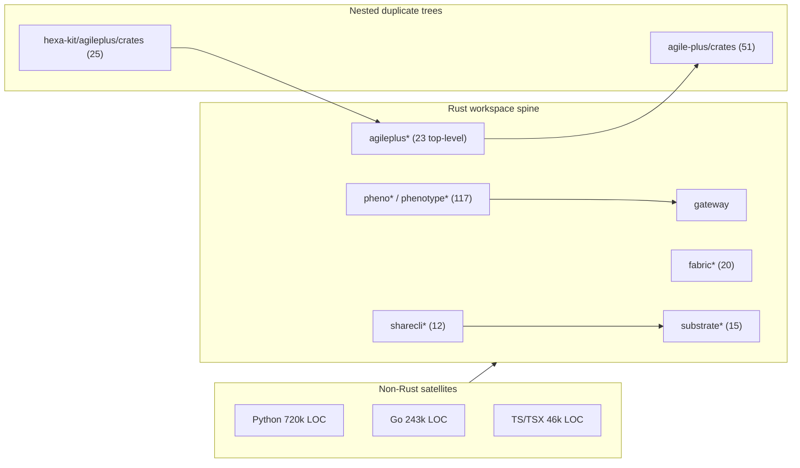

# Codebase Atlas - PhenoShared

| Field | Value |
|---|---|
| Repo | KooshaPari/PhenoShared |
| Commit | `origin/main` @ `6ec4ae563` (1,214 commits on main) |
| Working tree observed | `ad667428b` on `layer/governance-happy-path-claims` |
| Caveat | A concurrent process re-checked-out this working tree mid-analysis. Structural counts were stable across the run; CI/governance file deltas are possible. |
| Analysed | 2026-11-10 |
| Method | Static structural inspection of the working tree plus independent re-measurement of every headline count |
| Confidence | counts independently re-measured from the working tree; module purposes inferred from names and manifests |

## One-screen orientation

PhenoShared is a Rust-workspaced monorepo with heavy multi-language satellites, not one Rust crate.
The visible spine is `crates/` (13,848 tracked files) rooted in a real `[workspace]` with 283 declared crate paths.
The actual code mass is Python (~52% of code LOC), with Rust ~22% and Go ~18%.
It is also a host for absorbed products: `absorption/`, `_archived/`, `archive(s)/`, and vendored `.vendor/lancedb`.
Markdown outnumbers code (10,532 `.md` vs 7,209 `.rs`), so documentation is a first-class maintenance surface.
The dominant structural hazard is triple-vendoring of the AgilePlus family (23 + 51 + 25 crate dirs).
Naive per-directory LOC sums overstate the repo ~2.2x; de-duplicate before quoting size.
~87% of crate dirs are under 2.5k LOC: a broad platform surface, not a few large services.
No first-party Rust file exceeds 3,254 lines, yet 2-3.2k-line `lib.rs`/`main.rs` roots are common. Counts are reproducible only with the atlas's quoted commands.

## Scale and shape

| Metric | Value |
|---|---|
| Commits (all refs) | 3,635 at first measurement; 3,641 on re-measure 2026-11-10T07:38Z (live count, drifts as branches are pushed) |
| Commits (main) | 1,215 on `origin/main` (1,214 at first measurement); 1,210 on local `main` |
| Remote branches | 74 (live count 2026-11-10; drifts as branches are pushed) |
| Tags | 9 |
| Tracked files | 42,225 |
| Workspace members | 283 unique crate paths (287 quoted strings: 1 comment line, 3 duplicates) |
| Lockfile packages | 1,904 |
| Crate dirs (`crates/*`) | 372 total, 369 crate-like |
| First-party Rust LOC | 304,248 |
| `[[bin]]` targets / crates with `src/main.rs` | 154 / 85 |

Language split (~1.384M code LOC): Python ~52%, Rust ~22%, Go ~18%, Shell ~3.8%, TypeScript+TSX ~3.4%, JavaScript ~1.2%.

## Territory map

| Directory | Purpose | Size class |
|---|---|---|
| `crates/` | Rust workspace, core code spine | XL (13,848 files) |
| `docs/` | Records: ADRs, docs, `absorbed-from-*` trees | XL (11,721) |
| `absorption/` | Historical: absorbed upstream code | L (4,414) |
| `audits/` | Records: audit evidence | L (1,750) |
| `agents/` | Core: agent definitions | L (1,534) |
| `agileplus/` | Product surface | L (1,106) |
| `_archived/` | Historical | M (632) |
| `sites/` | Product: web surfaces | M (603) |
| `bench/` `scripts/` | Ops and tooling | M (391/388) |
| `servers/` `python/` `tests/` `infrakit/` `registry/` | Core code, tests, registry | M (386/314/297/265/147) |
| `archive(s)/` | Historical | M (225) |
| `state/` `traces/` `datasets/` | State and artifacts | S |
| `projects/` `handbook/` `kitty-specs/` | Records and specs | M (178/142/170) |
| `unity/` `apps/` `web/` `gui/` | Product surfaces | S-M |
| `.github/` | Ops: CI | S (141) |

## Rust workspace atlas

### substrate / fabric
Runtime graph, daemon, and CLI surfaces that back the fabric runtime; `substrate*` has 15 crate dirs, `fabric*` 20.

| Crate | LOC | Purpose |
|---|---|---|
| `fabric-graph` | 9,188 | Core graph store for the fabric runtime |
| `fabric-daemon` | 7,318 | Long-running fabric daemon |
| `fabric-cli` | 3,854 | Fabric command-line client |

### browser
Browser automation and lease brokering; only `substrate-browser-broker` is enumerated in the source inventory.

| Crate | LOC | Purpose |
|---|---|---|
| `substrate-browser-broker` | 4,845 | Broker for browser profile leases and sessions |

### eidolon
Sandboxed agent runtime with desktop and mobile frontends (`eidolon*` = 4 crate dirs).

| Crate | LOC | Purpose |
|---|---|---|
| `eidolon-sandbox` | 22,828 | Sandboxed execution core for Eidolon agents |
| `eidolon-desktop` | 7,702 | Desktop client surface |
| `eidolon-mobile` | 7,549 | Mobile client surface |
| `eidolon-core` | 3,833 | Shared core types and logic |

### pheno-compose
No `pheno-compose` crate is enumerated in the source atlas crate inventory.

| Crate | LOC | Purpose |
|---|---|---|
| UNKNOWN | UNKNOWN | Not listed in source inventory |

### sharecli
Terminal and fleet share layer (`sharecli*` = 12 crate dirs); largest non-agileplus family member.

| Crate | LOC | Purpose |
|---|---|---|
| `sharecli` | 90,061 | Main ShareCLI binary and command surface |
| `sharecli-fuse` | 7,879 | FUSE mount layer |
| `sharecli-ipc` | 4,700 | Inter-process messaging |
| `sharecli-session` | 4,194 | Session lifecycle management |
| `sharecli-fleet` | 3,685 | Fleet coordination |

### eyetracker
Gaze and eye-tracking family: 8 crate dirs, headed by the inference engine.

| Crate | LOC | Purpose |
|---|---|---|
| `eyetracker-inference` | 5,605 | Inference engine; the family's only crate measured above 5k LOC |
| `eyetracker-*` (7 further dirs) | UNKNOWN | Remaining eyetracker crates; LOC not itemized in source |

### routing / router
Cross-family request routing, the CLI dispatch surfaces, and the `engine-*` adapter layer the gateway drives.

| Crate | LOC | Purpose |
|---|---|---|
| `gateway` | 70,752 | Cross-family request routing; dispatches to the engine crates |
| `focus-cli` + `fabric-cli` | 7,719 | CLI dispatch surfaces (3,865 + 3,854) |

### omniroute
No `omniroute` crate is itemized in any inventory, family rollup, or directory map, and the ~324 crates that no inventory names are unclassified, so both presence and size are UNKNOWN.

| Crate | LOC | Purpose |
|---|---|---|
| UNKNOWN | UNKNOWN | No omniroute entry exists in the source |

### infra / config
Daemon, transport, and platform-shim crates from the source's INFRA subgraph; `gateway` and `hexa-kit` are sectioned elsewhere.

| Crate | LOC | Purpose |
|---|---|---|
| `fabric-daemon` + `teamcomm-daemon` | 10,937 | Daemon processes (7,318 + 3,619) |
| `substrate-browser-broker` + `apisync` + `pine-syscall` | 13,743 | Browser-broker, API-sync, and syscall shims (4,845 + 4,520 + 4,378) |
| `sharecli-{ipc,session,fleet}` | 12,579 | IPC/session/fleet transport daemons (4,700 + 4,194 + 3,685) |

### tui / gui
Terminal, desktop, mobile, and canvas presentation crates; `sharecli-thermal-tui` and `fabric-{tui,gui,web}` are named in the source but carry no crate LOC.

| Crate | LOC | Purpose |
|---|---|---|
| `eidolon-desktop` + `eidolon-mobile` | 15,251 | Desktop and mobile presentation crates (7,702 + 7,549) |
| `pheno-terminal` + `connector-canvas` | 9,588 | Terminal and canvas surfaces (5,640 + 3,948) |

### tests / support
The cross-repo `tests/` tree (297 tracked files, LOC not given) plus the FFI/FUSE/process-runtime support crates.

| Crate | LOC | Purpose |
|---|---|---|
| `focus-ffi` + `sharecli-fuse` + `pheno-proc-runtime` | 15,730 | FFI, FUSE, and process-runtime support crates (3,546 + 7,879 + 4,305) |

### other / absorbed
Duplicated and absorbed trees: `absorption/` 4,414 files, `_archived/` 632, `archive/`+`archives/` 225, `docs/absorbed-from-*`, `.vendor/lancedb`. LOC figures source-wide are `find`-based upper bounds (~2.2x overcount), and the source's remaining prefix families are summarized by counts only, not per-crate LOC.

| Crate | LOC | Purpose |
|---|---|---|
| `agile-plus/` | 132,228 | Nested workspace of 51 agileplus crates (duplicate copy) |
| `hexa-kit/` | 91,295 | Nested host of the third agileplus copy (25 nested crates) |

### Family totals

| Family | Crates | LOC |
|---|---|---|
| substrate/fabric | 3 named of 35 dirs (`substrate*` 15, `fabric*` 20) | 20,360 (9,188 + 7,318 + 3,854) |
| browser | 1 named | 4,845 |
| eidolon | 4 | 41,912 (22,828 + 7,702 + 7,549 + 3,833) |
| pheno-compose | UNKNOWN | UNKNOWN |
| sharecli | 5 named of 12 dirs | 110,519 (90,061 + 7,879 + 4,700 + 4,194 + 3,685) |
| eyetracker | 8 | 5,605 itemized; family total UNKNOWN |
| routing/router | 3 named (+7 `engine-*`) | 78,471 itemized (70,752 + 3,865 + 3,854) |
| omniroute | UNKNOWN | UNKNOWN |
| infra/config | 8 named | 37,259 (10,937 + 13,743 + 12,579) |
| tui/gui | 8 named (4 with LOC) | 24,839 itemized (15,251 + 9,588) |
| tests/support | 3 named (+`tests/` tree) | 15,730 (3,546 + 7,879 + 4,305) |
| other/absorbed | 2 named + absorbed trees | 223,523 (132,228 + 91,295) |

**Reconciliation, and why the column does not sum.** The family rows are a ledger of what the source
tiers named, not a census. Two properties follow, and neither is a defect in the source:

- **Not exhaustive.** Roughly two dozen crates are individually named, against 372 `crates/` dirs and
  283 declared workspace paths. The remainder (~324 crates) is named by no inventory and carries no
  per-crate LOC anywhere, so it is recorded UNKNOWN rather than estimated.
- **Not additive.** Families overlap by design. `fabric-cli` appears under both substrate/fabric and
  routing/router; `eidolon-desktop`/`-mobile` under both eidolon and tui/gui; `sharecli-fuse` under both
  sharecli and tests/support; `fabric-daemon`, `substrate-browser-broker`, and `sharecli-{ipc,session,fleet}`
  under both substrate/browser/sharecli and infra/config. Summing the column double-counts those crates.

Consequently the workspace-member LOC is NOT reconciled to the 304,248 first-party Rust LOC stated in
"Scale and shape". The gap is unmeasured, not zero.

## Non-Rust surfaces

PhenoShared is a Rust workspace with heavy multi-language satellites; the actual code mass is Python.

| Language | Tracked files | LOC | Purpose / note |
|---|---|---|---|
| Python `.py` | 5,709 | 720,862 | Largest by LOC (~52%). Entrypoints: `python/` (314), `servers/` (386), `agents/` (1,534) |
| Go | 2,819 | 243,250 | ~18% of code LOC; `go-fabric/`, `linux-client/`, `windows-client/`, `native/` |
| TypeScript `.ts` | 2,884 | 30,445 | ~3.4% of measured LOC |
| TSX `.tsx` | 2,327 | 16,149 | React surfaces (`sites/`, `web/`, `dashboard/`) |
| JavaScript `.js` | 375 | 16,339 | ~1.2% of measured LOC |

**File counts are `git ls-files` tracked counts and are authoritative. The LOC column is not, and is
not reconcilable with them:** ~30k LOC across 2,884 `.ts` files (~11 LOC/file) and ~16k across 2,327
`.tsx` files (~7 LOC/file) are far below a plausible per-file average, so those LOC figures describe a
filtered subset whose inclusion rule was not recorded. Treat the LOC column as a lower bound per
language, not a total. Measured tracked total across rs+py+ts+tsx+js+go+sh is 21,797 files.
Plugin manifest also declares 3 Python MCP servers (`servers/substrate/*.py`, `servers/pheno-org/*.py`);
on-disk presence UNPROVEN.

## Runtime surface

154 `[[bin]]` declarations across tracked manifests, and 85 crates under `crates/` with a top-level `src/main.rs`. Service-forming binaries: `fabric-daemon`, `fabric` (`fabric-cli`), `brokerd` (`substrate-browser-broker`), `phinbox`, `phenotype-daemon` (`pheno-agent`), `teamcomm-daemon`, `sharecli-ipc`, `focalpoint-webhook-server`, `focalpoint-mcp-server` (`focus-mcp-server`), `gateway-tools serve`, `start_api` (`agileplus-api`). One-shot tools: `qgate`, `ptx`, `audit-privacy`, `tokenledger`, `docs-health`, `sbom-gen`, `perfharness`, `phenotype-router`, `hexakit`, `agileplus`, `sharecli`, `argis-monitor`.

| Service | Port / socket | Protocol |
|---|---|---|
| `fabric-daemon` | 9400 wire, 9401 metrics | TCP JSON + HTTP metrics |
| `brokerd` | 127.0.0.1:8787 | HTTP (lease + fencing token) |
| `phinbox` | 7117 default + Unix socket | HTTP + UDS |
| `phenotype-daemon` | `/tmp/phenotype-daemon.sock`, TCP 127.0.0.1:9456 | JSON-RPC |
| `teamcomm-daemon` | Unix socket + pidfile | UDS |
| `sharecli-ipc` | `~/.local/share/sharecli/ipc.sock` | UDS |
| `focalpoint-mcp-server` | 127.0.0.1:8473 | MCP HTTP/SSE |
| `gateway-tools serve` | 8081 | HTTP |
| `agileplus-api` | `API_HOST:AppConfig.api.port` | HTTP |

Defect: `9456` (main.rs) vs `8953` (`DEFAULT_TCP_PORT`, protocol.rs:186) for the same phenotype-daemon constant; runtime value UNKNOWN. Compose-only: 9090, 3000, 5432, 6379, 8000, 3100, 8090, 8080, 8081, 8091, 50051 (gRPC), 30100 (vLLM unit, binary unproven).

MCP servers: `browser-broker-mcp` (stdio, no socket), `phinbox_mcp` (stdio), `focalpoint-mcp-server` (HTTP/SSE). Library-only: `phenotype-mcp-sdk-rs`, `mcp-server`, `driver-mcp`; `teamcomm-mcp` not inspected. Tool counts UNKNOWN.

GUI/TUI: `fabric-tui`, `substrate-tui` (terminal); `fabric-gui` (Tauri, workspace-excluded); `fabric-tray`, `sharecli-tray-linux`/`-windows`; `eidolon-desktop`, `eidolon-mobile`, `apps/phinbox-app`. ~50+ crates derive `clap::Parser`.

## Data and knowledge surfaces

Markdown outnumbers code: 10,532 `.md` vs 7,209 `.rs`, 5,709 `.py`.

| Surface | Count | Note |
|---|---|---|
| `docs/` | 11,721 files (2,494 `.md`) | docs, ADRs, `absorbed-from-*` |
| `audits/` | 1,750 | audit records |
| Markdown total | 10,532 tracked | repo-wide; `docs/` holds 2,494 of them |
| `kitty-specs/` | 170 | specs |
| `projects/` | 178 | records |
| `handbook/` | 142 | records |
| `state/` | 193 | state artifacts |
| `bench/` | 391 | ops/benchmarks |

Record/governance dirs: `adrs/`, `architecture/`, `spec/`+`specs/`+`agileplus-specs/`, `plans/`, `findings/`, `audits/`+`audit/`, `evidence/`, `attestations/`, `verification/`+`verifier/`, `worklog/`+`worklogs/`, `governance/`+`phenotype-governance/`, `grades/`, `promotion/`, `risks/`, `patterns/`, `contracts/`, `schemas/`, `tokens/`, `locales/`, `anti-patterns/`, `beads/`. State: `traces/`, `datasets/`, `sbom/`, `assets/`, `experiments/`, `playground/`. Per-directory counts beyond the top 22 are UNKNOWN. Absorbed (excluded from first-party metrics): `absorption/` 4,414, `_archived/` 632, `archive/`+`archives/` 225.

## Dependency and supply-chain shape

- No dependency-graph analysis was performed; family boundaries are inferred from name prefix, not import edges.
- Lockfile size is measured: 1,904 package entries in `Cargo.lock`. Duplicate dependency versions and per-crate license posture were not analysed: **UNKNOWN** (the repo-wide license split is in the supply-chain evidence, not per crate).
- Vendoring is material: a `.vendor/lancedb` third-party tree (9 of the 10 largest tracked `.rs` files are vendored or archived absorbed copies), and AgilePlus is vendored three times (`agileplus-*` 23 dirs, `agile-plus/crates/` 51, `hexa-kit/agileplus/crates/` 25). Raw per-directory LOC therefore overstates the codebase ~2.2x.
- `sbom-gen`, `audit-privacy`, `acceptance-contract` binaries exist and `sbom/` is present; output state UNKNOWN.

## Architecture graph

## Reading order for a newcomer

1. `Cargo.toml` — real `[workspace]` with an explicit `members` list; the only honest index of the spine.
2. `crates/` top level — 372 dirs; a platform surface, ~87% under 2.5k LOC.
3. `crates/gateway/` — one of four mega crates; entry surface for most runtime paths.
4. `crates/agile-plus/` — nested workspace of 51; read before any top-level `agileplus-*`.
5. `crates/hexa-kit/` — holds the third agileplus copy; explains apparent LOC duplication.
6. `crates/agileplus-cli/` — smallest honest entry into AgilePlus behaviour.
7. `crates/sharecli/` + `sharecli-*` — 90k LOC family; second-largest product surface.
8. `crates/phenotype-plugins/` — plugin contract; how the pheno* family composes.
9. `absorption/` — 4,414 files of absorbed products; provenance before trusting a crate.
10. `docs/absorbed-from-*` — per-product absorption docs, read with `ABSORPTION_MANIFEST.md`.

## Navigation cheat sheet

| If you want X | Go to Y |
|---|---|
| Workspace member list | `Cargo.toml` (`members = [`) |
| All binary targets | `grep -r '\[\[bin\]\]' --include=Cargo.toml` |
| Gateway/runtime entry | `crates/gateway/` |
| AgilePlus domain logic | `crates/agileplus-domain/` |
| AgilePlus CLI verbs | `crates/agileplus-subcmds/` |
| AgilePlus nested workspace | `crates/agile-plus/crates/` |
| Third agileplus copy | `crates/hexa-kit/agileplus/crates/` |
| ShareCLI session/fleet code | `crates/sharecli-session/`, `sharecli-fleet/` |
| Fabric graph/daemon | `crates/fabric-graph/`, `fabric-daemon/` |
| Plugin contracts | `crates/phenotype-plugins/` |
| Absorbed product history | `absorption/`, `docs/absorbed-from-*` |
| Vendored third-party (exclude from metrics) | `.vendor/lancedb` |

## Confidence and gaps
- **MEASURED** — 42,225 tracked files; Rust 304,248 LOC; Python 720,862; Go 243,250; 372 crate dirs; 154 `[[bin]]`; 10,532 markdown; HEAD `ad667428b` on `layer/governance-happy-path-claims`.
- **MEASURED** — three agileplus copies (23 / 51 / 25 crate dirs) at `crates/`, `crates/agile-plus/crates/`, `crates/hexa-kit/agileplus/crates/`.
- **INFERRED** — per-crate LOC tiers are `find` upper bounds (untracked + nested double-count); top-45 ~677k is ~2.2x tracked total. "Platform surface, not services" rests on the <2.5k long tail, not runtime topology.
- **UNKNOWN** — real crate dependency edges (graph groups by name prefix); which agileplus copy is canonical (no ADR); and the 1 unexamined modified working-tree path.
