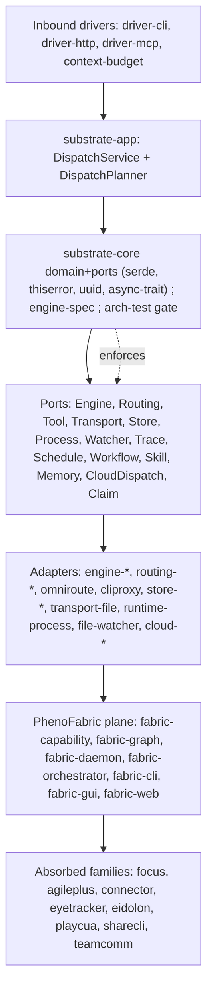

# Product Dossier - PhenoShared

## Executive summary

- **What it honestly is:** a *container repository*, not a product. It is a shared-infrastructure foundation monorepo holding the Rust crates, reusable GitHub Actions workflows and composite actions, and shared documentation (including the Global Handbook) that the rest of the fleet consumes (`README.md:3-6`).
- **Role:** the org's *shared layer*, deliberately not a user-facing product surface; category is "Shared infrastructure / foundation monorepo" (`README.md:3-4`; `docs/dossiers/HANDOFF-PHENOSHARED.md`, "Role: Pooled foundation monorepo (Rust workspace + absorbed repos)").
- **Scale:** 283 unique declared workspace member paths (`Cargo.toml` `members` holds 287 strings: 1 comment, 3 duplicates), 372 entries under `crates/`, 84 reusable workflow files, 5 composite actions, 178 project manifests under `projects/*.json`, 2,494 Markdown files under `docs/` (measured 2026-11-10; README snapshot numbers are older and lower).
- **Shape:** a Rust workspace (edition 2021, MSRV 1.80, version `0.3.10`) plus companion TypeScript packages.
- **Flagship:** the `substrate` spine - a dispatch facade that routes a task to the best available coding engine through a deterministic planner and hexagonal ports, so consumers depend on one facade instead of wiring adapters by hand (`README.md:49-56`).
- **Boundary enforcement is mechanical:** `arch-test` fails the build when a dependency edge crosses the domain/adapter boundary the wrong way (`README.md:55-56`).
- **It is an absorption hub:** PhenoFabric (997 files, 118K lines), PhenoRegistry (3,848 files, 2.1M lines), PhenoInfra, PhenoGfx and FocalPoint were absorbed; 33 per-project absorption records live in `docs/absorption/` with an index at `docs/ABSORPTION_INDEX.md`.
- **Maturity verdict (source's own words):** "production-grade foundation that is *actively growing but visibly mid-consolidation*." Build health was last verified 2026-09-16 (`cargo check --workspace` PASS, 0 errors, 47 warnings at `main` @ `1056f3e8`); **current build status is UNKNOWN** - no build was run for this dossier.
- **Known drift:** the README's headline table still reports the older counts (76 packages / 329 manifests) while the tree has grown to 283 members / 372 crate directories; `governance/` has no README despite shipping four happy-path governance files.
- **Real positioning risk:** two self-descriptions coexist - README calls it "a container repository, not a single-purpose project", while `PRD.md:3` calls it "a Rust workspace ... with no inter-crate dependencies", which contradicts the actual substrate spine.
- **Governance posture:** commits carry ledger trailers (`tx-agent`, `tx-validated`), history is append-only, and the file-size budget is "under 500 lines, with 350 as the goal" (`README.md:417-424`).

## Identity card

| Field | Value | Evidence |
|---|---|---|
| Name | **PhenoShared** (former name: **PhenoAI**) | `README.md:1`; `docs/dossiers/HANDOFF-PHENOSHARED.md` |
| Repo | `KooshaPari/PhenoShared` (canonical origin; `KooshaPari/pheno` redirects; local clones often at `repos/pheno`) | `README.md:7-9`; `gh repo view` |
| Visibility | **PUBLIC** (not private, not archived) | `gh repo view KooshaPari/PhenoShared` -> `visibility: PUBLIC`, `isPrivate: false`, `isArchived: false` |
| Created | Repo created **2026-04-03** (GitHub `createdAt`); local history starts earlier at first commit `043003e9a`, 2026-03-17 ("Initial commit: workspace setup") | `gh repo view`; `git log --reverse` first entry |
| Last push | **2026-11-10** 05:20 UTC (GitHub `pushedAt`); newest local commit `ad667428b`, 2026-11-09 20:29 PT | `gh repo view`; `git log -1` |
| Commit under analysis | Basis `origin/main` @ `6ec4ae563`; working tree observed at `ad667428b` - "fix(campaign): stop 63 scripts depending on one machine's absolute home path", 2026-11-09 | `git log -1 ad667428b`; `git rev-parse origin/main` |
| Primary language | **Rust** (workspace edition 2021, MSRV 1.80, version `0.3.10`); companion TypeScript packages | `gh repo view` -> `primaryLanguage: Rust`; `Cargo.toml`; `PRD.md:3` |
| License | **MIT OR Apache-2.0** (GitHub reports the MIT license; repo ships `LICENSE-MIT` and `LICENSE-APACHE`) | `README.md:27`; `gh repo view` -> `licenseInfo.key: mit` |
| Lifecycle stage | **Active growth / mid-consolidation** - a production-grade foundation that absorbed several products; build last verified 2026-09-16, current build UNKNOWN | Source maturity verdict; `docs/dossiers/HANDOFF-PHENOSHARED.md` |
| Category | **Shared infrastructure / foundation monorepo** (not a user-facing product) | `README.md:3-4`; `docs/dossiers/HANDOFF-PHENOSHARED.md` |

## Problem and positioning

**Pain addressed** (`PRD.md:3`, verbatim): "`phenotype-shared` is a Rust workspace (with companion TypeScript packages) providing domain-agnostic, reusable infrastructure primitives for the Phenotype ecosystem. Each crate is independently consumable with no inter-crate dependencies. The workspace is the canonical location for shared infrastructure so that every Phenotype service can depend on the same battle-tested primitives rather than reinventing them."

**Why a monorepo** (`README.md:39-41`): "The workspace consolidates infrastructure, tooling, agent frameworks, connectors, compute-mesh IaC, and ecosystem governance that previously lived across many standalone repositories." Four co-located cross-org functions: shared Rust crates (`crates/`), reusable workflows (`.github/workflows/`, 84 files, called from other repos), shared composite actions (`.github/actions/`, 5), and shared docs (`docs/`, `handbook/` - Global Handbook, ADRs, absorption records, session artifacts).

**What it replaces:**
- The **many standalone repositories** it absorbed, with the trail recorded in `docs/ABSORPTION_INDEX.md` and `docs/absorption/` (33 per-project records); absorbed families include PhenoFabric, PhenoRegistry, PhenoInfra, PhenoGfx and FocalPoint.
- **Hand-wired adapters:** the substrate facade means consumers "depend on one facade instead of wiring adapters by hand" (`README.md:49-56`).
- **Parallel reimplementations:** governance requires checking whether an existing crate already covers a cross-domain dependency, and "the workspace prefers extending an adapter over a new parallel implementation" (`README.md:417-424`).
- **Reinvented primitives:** services are meant to depend on "the same battle-tested primitives rather than reinventing them" (`PRD.md:3`).

**Positioning caveat:** the PRD's "no inter-crate dependencies" claim contradicts the actual substrate spine, where `substrate` depends on `substrate-core` and `substrate-app` depends on core ports (`README.md:57-70`).

## Capability map
README counts vs measured counts group differently (last-hyphen basis), so they are not comparable (R-02). No build was run: binary-level maturity is UNKNOWN where noted.

### `substrate-*` — core dispatch spine
**Purpose:** one org facade routing a task to the best available coding engine through a deterministic planner over hexagonal ports.
**Crates:** `substrate` (facade; features `app`/`spec`/`a2a`), `substrate-core`, `substrate-app`, `engine-spec`, `arch-test`; drivers `driver-cli`/`-http`/`-argv`/`-mcp`, `context-budget`; engine adapters; routing/store/runtime/workflow (`substrate-trace`, `-schedule`, `-dag`, `-skills`, `-memory`, `-tui`, `-a2a`); cloud dispatch.
**Entry points:** binaries `substrate`, `substrate-http`; library `crates/substrate`.
**Maturity/status:** first two `Cargo.toml` members; `arch-test` fails the build on boundary crossings (`README.md:55-56`); failover ADR-0030 accepted, impl landed 2026-09-06 — UNKNOWN (build not verified).

### `fabric-*` — PhenoFabric execution/data/IO substrate
**Purpose:** capability inventory, topology, route compilation, leases, surface isolation, streaming.
**Crates:** `fabric-capability` (+`-ffi`), `fabric-checker`, `fabric-graph`, `fabric-persist`, `fabric-daemon`, `fabric-orchestrator`, `fabric-cli`, `fabric-workspace`, `fabric-frame-transport`, `fabric-gui` (Tauri v2), `fabric-web` (Leptos WASM), `fabric-tray`, `fabric-tui`, `fabric-terminal`.
**Entry points:** `fabric` binary, `fabric-daemon`, Tauri app, WASM SPA.
**Maturity/status:** absorbed from PhenoFabric at `365a3572` (997 files, 118K lines); ADR-0001/0002/0003/0020/0033/0035; `fabric-gui/src-tauri` excluded from the workspace (GTK/WebKit/libsoup-3.0) — PARTIAL.

### `pheno-*` / `phenotype-*` — shared primitives long tail
**Purpose:** absorbed product-family primitives plus infra and observability tooling.
**Crates:** PhenoRegistry (`phenotype-project-registry`, `phenotype-service-registry`, `phenotype-health`); PhenoInfra (`phenotype-crypto`, `-observability`, `-policy-engine`); PhenoGfx (`phenotype-gfx`, `phenotype-voxel` shim); `pheno-otel`, `fake-forge`, `fake-codex-cloud`.
**Entry points:** library crates only.
**Maturity/status:** absorptions at `f7ab4cdb` (3,848 files, 2.1M lines), `6c9b79ca`, `25c8dde1` — UNKNOWN (no build/test recorded).

### `focus-*` — FocalPoint productivity platform
**Purpose:** a complete productivity platform (FocalPoint) shipped alongside its own language, rules engine, scheduling, coaching, rewards/penalties and plugin SDK.
**Crates:** 43 `crates/focus-*` directories, every one carrying a `Cargo.toml`; 25 are explicit root `members`, the rest arrive as path-deps of those members. Largest: `focus-ffi` (3,437 LOC), `focus-cli` (3,093), `focus-ir` (2,491).
**Entry points:** 7 crates declare `[[bin]]` — `focus-cli`, `focus-mcp-server`, `focus-ffi`, `focus-webhook-server` among them; it is a runnable product, not a library pile.
**Provenance:** one bulk-extraction commit, `19f8e0ebe` (2026-09-16, "extract 53 crates from FocalPoint"). That 53 reconciles as 43 `focus-*` plus 9 `connector-*` (one unaccounted). **No `docs/absorbed-from-FocalPoint` manifest exists**, and `docs/ABSORPTION_INDEX.md` contains no `focalpoint`/`focus-` entry — so this is the largest absorption in the repo with no absorption record.
**Maturity/status:** 43,601 LOC across the 43 crates' `src/` trees (47,037 including tests, benches and examples). Zero core dependency: no `phenotype-*`, `substrate-*` or `fabric-*` crate depends on any `focus-*`; the only inbound edges are the 9 `connector-*` crates from the same extraction. Build/test state UNKNOWN.

### `agileplus-*` — AgilePlus planning and sync
**Purpose:** domain, API, gRPC, sqlite, git, NATS, P2P sync, triage, telemetry.
**Crates:** nested `crates/agile-plus/` workspace plus root `agileplus-*`.
**Entry points:** UNKNOWN.
**Maturity/status:** ADR-005 and ADR-0016 accepted; ADR-012 proposed — PARTIAL (governance accepted, plugin architecture still proposed).

### `connector-*` / `eyetracker-*` / `engine-*` / absorbed runtimes
`connector-*` (9): GitHub/Linear/Notion/Fitbit/Strava/GCal/Readwise integrations — PARTIAL (README prefix table only). `eyetracker-*` (8): camera/cli/core/domain/ffi/inference/math; `eyetracker-cli` implied — PARTIAL (membership only). `engine-*` (7): `EnginePort` adapters plus `engine-conformance` harness-agnosticism proof — PARTIAL. Absorbed runtimes `eidolon-*` (`5f0ffd08`), `playcua-*` (`8fdd395d`), `sharecli*` (ADR-0015), `teamcomm-*`, `pheno-compose-*` (ADR-ECO-021), `pheno-proc-runtime`, `hexa-kit`, `argis-extensions`, `Cmdra` — UNKNOWN. `store-*`/`cloud-*`/`driver-*` backends — UNKNOWN. Non-Rust surfaces (`apps/`, `platform/`, `servers/`, `serving/`) contents — UNKNOWN.

## Architecture
Hexagonal (ports and adapters), enforced by `arch-test`, which fails the build when an edge crosses the domain/adapter boundary the wrong way (`README.md:49-56`). Layers: **domain/core** `substrate-core` (domain + ports; depends only on `serde`, `thiserror`, `uuid`, `async-trait`) → **application** `substrate-app` (`DispatchService`, `DispatchPlanner`) → **ports** (`EnginePort`, `RoutingPort`, `ToolPort`, `TransportPort`, `StorePort`, `ProcessPort`, `WatcherPort`, `TracePort`, `SchedulePort`, `WorkflowPort`, `SkillPort`, `MemoryPort`, `CloudDispatchPort`, `ClaimPort`, `MailboxStore`, `EventStorePort`) → **adapters** (`engine-*`, `routing-*`, `omniroute-adapter`, `cliproxy-adapter`, `store-*`, `transport-file`, `runtime-process`, `file-watcher`, `cloud-*`) → **inbound drivers** (`driver-cli`, `driver-http`, `driver-mcp`) → **facade** `substrate`. A second parallel plane, PhenoFabric, is documented in `docs/architecture/` (api, control-plane, graph-runtime, object-plane, protocols, route-compiler, scheduler, security, state-machines), with ADR-0022 keeping the coordinator off payload and realtime hot paths.

Diagram caveat: `AD --> F` and `F --> AB` are narrative edges (README frames Fabric as the execution/data/I-O substrate), not measured Cargo dependencies; real dependency direction is UNKNOWN.

**Shared-kernel contract:** each crate is independently consumable with no inter-crate dependencies, and the workspace is the canonical location for shared infrastructure so every Phenotype service depends on the same battle-tested primitives rather than reinventing them (`PRD.md:3`). Tension: that no-inter-crate-dependency claim contradicts the actual spine, where `substrate` depends on `substrate-core` and `substrate-app` depends on the core ports (`README.md:57-70`).

## Absorption history

PhenoShared (formerly **PhenoAI**) is a consolidation monorepo whose purpose is to be the durable home other Phenotype repos fold into — not a library, not a single app. HEAD `ad667428b`; 372 crate dirs, 283 unique declared workspace members, Rust + Go + JS/TS.

| Absorbed source | Date | Resulting path | Status |
|---|---|---|---|
| PhenoInfra | 2026-09-16 | `absorption/PhenoInfra/` (2537 files) | copied; source already archived |
| PhenoMLX-temp | 2026-09-16 | `absorption/PhenoMLX-temp/` (1349 files) | copied; **only** absorption tree wired into workspace (38 refs) |
| phenoDesign-visual-production-v2 | 2026-09-17 | `absorption/phenoDesign-visual-production-v2/` (180 files) | copied; source left **unarchived** pending operator confirmation |
| phenotype-canonicalization | 2026-09-17 | `absorption/phenotype-canonicalization/` (44 files) | copied whole; source unarchived |
| phenotype-cvp-audit-2026-09-14 | 2026-09-17 | `absorption/phenotype-cvp-audit-2026-09-14/` (7 files) | copied; source unarchived |
| PhenoCompose (PhenoTooling @ `2feccc2f`) | 2026-11-08 | `docs/absorbed-from-PhenoCompose/` (216 KB) | in-tree; `6fd2835e5` ported the 41 unabsorbed files |
| PhenoObservability (PhenoTooling) | 2026-11-08 | `docs/absorbed-from-PhenoObservability/` (1.1 MB, 140 files) | in-tree; `6e5fa283a` |
| PhenoTooling (bulk) | UNKNOWN | `docs/absorbed-from-PhenoTooling/` (**70 MB**) | largest absorbed payload outside `archives/` |
| PhenoGoKit (`go-sdk`) | UNKNOWN | `docs/absorbed-from-PhenoGoKit/` (1.5 MB) | GitHub repo **404**; recovered from a local clone whose origin is a local path |
| herdr plugins (jcode/forgecode/helioslite) | UNKNOWN | `absorption/herdr-{jcode,forgecode,helioslite}/` (8 files each) | in-tree, **0 workspace refs** |
| PhenoFabric | 2026-08-28 | `crates/fabric-*` (997 files, 118K lines) @ `365a3572` | absorbed into substrate |
| PhenoRegistry / PhenoInfra crates / PhenoGfx | UNKNOWN | `crates/phenotype-*` @ `f7ab4cdb` / `6c9b79ca` / `25c8dde1` | absorbed into substrate |

**Governance implication.** The manifest apparatus (`docs/absorbed-from/*/README*.md`, `docs/ABSORPTION_INDEX.md`, `docs/absorption/` with 33 per-project records) is the strongest artifact in the repo: every absorbed source carries repo, revision and date. But absorption is **staged, not landed**. The 2026-11-08 wrapup produced 18 remote `wrapup/*-20261108` branches (1–498 commits ahead) plus the consolidation branch `origin/integration/absorbed-20261109` (`45e7c8a6a`) — **all 19 UNMERGED** into `origin/HEAD` as of 2026-11-10. So the tree holds three archive generations (`_archived/`, `.archive/`, `archives/`) alongside `absorption/` (48 MB) and `docs/absorbed-from*` (~73 MB): ≈224 MB of forensic footprint with no single authoritative merge point. The "what is actually merged" answer is per-commit (`6e5fa283a`, `6fd2835e5`, `dee522c88`, `3b45203b0`), not per-branch. Two consequences for governance: (1) unarchived sources (phenoDesign, canonicalization, cvp-audit) are still-live upstreams and must not be deleted until the operator confirms; (2) the root manifest reaches into `absorption/PhenoMLX-temp/...`, so the build graph depends on content that is not on trunk.

## Ecosystem position

Registry id `pheno`, status `active`, tier `phenotype-framework`, architecture `layered` (`phenotype-registry/catalog/registry.yaml:635-640`). It is a first-class, actively tracked registry entry with a maintained commit ledger (`PhenoShared.story.md`, `PhenoShared.rollup.json`: 1965 commits, 285 merges, 29 active weeks, peak 2026-W42 = 429), not a passive inventory row.

| Consumer | Evidence | Verdict |
|---|---|---|
| Sibling Phenotype repos (`repos/*/Cargo.toml`) | bounded `rg` for `PhenoShared` and `KooshaPari/PhenoShared` matched only PhenoShared's own manifest | **No sibling repo declares PhenoShared as a Cargo dependency** (path or git) |
| Internal workspace crates | 372 crate dirs / 283 members consume each other | Intra-repo, not ecosystem consumption |
| External crates.io consumers | crates.io API returned HTTP 403 to the probe | UNKNOWN |
| npm/pypi/binary/MCP consumers | not probed | UNKNOWN |
| Release surface | only `promptscrape` v0.1.0–v0.1.2; 72 crate manifests set `publish = false` | No observable library-consumer surface |

**Dependencies (outbound).** Root `Cargo.toml` declares **no** `git =` source deps (`rg 'git = '` → 0 matches); per-member-crate outbound git deps were not exhaustively enumerated → UNKNOWN. The root manifest is 1028 lines and lists 372 member directories, including paths into `absorption/PhenoMLX-temp/...`.

**Org layer.** Tier `phenotype-framework` places PhenoShared in the shared substrate layer *beneath* product repos: `substrate-*` (dispatch spine, browser broker/CDP/MCP), `fabric-*` (execution/IO), `agileplus-*` (planning/sync), `connector-*`, plus `engine-spec` / `acceptance-contract` / `arch-test` / `phenotype-config-core`. It is a shared kernel **and** a consolidation hub, explicitly not a leaf library and not a user-facing product. Two competing self-descriptions coexist — `README.md:3` "container repository, not a single-purpose project" vs `PRD.md:3` "domain-agnostic, reusable infrastructure primitives … no inter-crate dependencies" — and the PRD claim contradicts the substrate spine's real dependency direction. ~60% of commits are agent/automation authored. GitHub: public, created 2026-04-03, last push 2026-11-10, ~256 MB, Rust, 0 stars, PR sequence up to **#828**, but only 4 releases (all `promptscrape`) — high churn, no release cadence.

## Contract and decision record

Three mutually unaware ADR stores: `docs/adr/` (90 files, singular), `docs/adrs/` (25, plural), `adrs/` at repo root (10, a third numbering series); copies also nested under `docs/atlas/adr`, `docs/phenotype-docset-v1.1/adr`, `docs/specs/pheno-specs/adrs`. No machine-readable index; only ~28 of the 90 expose a parseable `Status:` field, and prefix `0001` is used **4×** inside `docs/adr` (0002/0003/0004/0005/0006 3× each), so a bare id is unresolvable — always cite the slug. Rows below are verified titles/statuses/decision lines; the ADR id is reproduced as it appears on disk.

| id | title | status | decision |
|---|---|---|---|
| ADR-0001 | Record Architecture Decisions | Accepted | Use Nygard-style ADRs: numbered markdown under `docs/adr/`. |
| ADR 0001 | Define Phenotype Fabric as the execution/data/I-O substrate | Accepted | Fabric owns discovery, placement, residency, transport, I/O, surfaces, RT QoS — not product intent or session history. |
| ADR 0001 | Hybrid Compute Mesh (7 nodes) | Accepted | 7-node mesh: always-on cloud free-tier nodes plus a home desktop over a Tailscale control plane. |
| ADR-0002 | Hexagonal ports/adapters architecture | Accepted | Binding layout: core holds contracts, adapters plug engines/transports/stores; core never depends on an adapter. |
| ADR 0002 | One packaged product shell over modular adapters | Accepted | One installer/UI/CLI/API identity; capabilities are replaceable adapters with independent health and versioning. |
| ADR 0002 | OCI Ampere as Primary Backbone | Accepted | Two Oracle Cloud Ampere A1 Flex VMs host Forgejo, Woodpecker and Vaultwarden. |
| ADR 0003 | Use a PipeWire/JACK-inspired typed node-port-link graph | Accepted | Devices/resources/surfaces are typed nodes; links express intent, compiled routes express implementation. |
| ADR 0003 | Home Desktop as Heavy Runner | Accepted | Attach the home Mac to the tailnet as `home-mac`, a Woodpecker agent labeled `[self-hosted, heavy, home]`. |
| ADR-0004 | Atomic claim/lease for the single-instance guard | Accepted | `substrate-serve-lock` claims via SQLite + WAL. |
| ADR-0005 | SQLite as the default store | Accepted | Use `rusqlite` with the `bundled` feature. |
| ADR-0006 | Structured tracing via a `TracePort` | Accepted | Adopt a two-tier observability model behind a pluggable trace port. |
| ADR-0007 | Do not introduce a universal database or ontology | Accepted | Share IDs, envelopes and schemas; each product keeps its own authoritative state. |
| ADR 0015 | Keep ShareCLI standalone | Accepted | Do not absorb ShareCLI; integrate it as a privileged runtime client via adapters. |
| ADR 0016 | Preserve AGSLAG, AgilePlus, thegent, Tracera and ledger authority | Accepted | AGSLAG=worth, AgilePlus=commitments, thegent=dispatch, Fabric=execution, Tracera=evidence, SessionLedger=history; exchange IDs/events only. |
| ADR 0017 | Agents may publish and request attention but not steal focus | Accepted | Capability-scoped publication/attention APIs; human focus takeover requires explicit policy or action. |
| ADR 0020 | Use Phenotype Fabric as a working name only | Accepted | Provisional name; no irreversible namespace or legal claims until boundary validation. |
| ADR-005 | AgilePlus Governance Boundary | Accepted | Fixes what AgilePlus owns and does not own (per-product governance boundary). |

Also present but not read here: `0030-route-failover-model.md` (failover accepted, impl landed 2026-09-06 in `crates/fabric-graph/src/failover.rs`), `0033-fabric-daemon-architecture.md`, `0035-gui-suite-architecture.md`, `ADR-012` Plugin Architecture for AgilePlus (Proposed), `ADR-016` (Accepted), and the `docs/adrs/ADR-ECO-001..023` ecosystem series.

## Knowledge base

**Corpus.** 10,532 tracked markdown files / 716,333 lines spread across **149** top-level directories. `docs/` (2,581 files, 105 subdirs) is the intended canonical corpus, but `crates/` (3,518 — per-crate AGENTS/CLAUDE/SPEC boilerplate), `audits/` (1,290), `absorption/` (1,102) and `docs/specs/pheno-specs/` (393, a nested vendored repo with its own LICENSE/CODEOWNERS/CHARTER) compete with it. Classification: ~400 canonical, ~1,600 session/dated, ~1,102 absorbed/vendored, ~2,500 boilerplate, 1,002 temporal (SUMMARY/STATUS/FINAL/PHASE). Three archive generations hold 329 files; three separate archive trees plus `absorption/` and `docs/absorbed-from*` duplicate each other's content with 58–95% basename overlap between supposedly distinct trees. 52 session dirs under `docs/sessions/` span 2026-02-26 → 2026-11-07 with two coexisting name conventions.

**Read first, in order.** 1. `README.md:3-6` (positioning) then `PRD.md:3` (the competing claim). 2. `docs/atlas/` — `PRD.md`, `HLD.md`, `LLD.md`, `ALD.md`, `DOMAIN_MODEL.md`, `qa/` (assurance contract, metrics, negative controls), `products/`, `codebase/FILES.md` (22,660-line generated index). 3. `docs/adr/` for decisions. 4. `docs/boundary/` (166 per-product boundary files) and `docs/intent/` (139). 5. `docs/ABSORPTION_INDEX.md` + `docs/absorbed-from/*` (33 per-project absorption records). 6. `docs/sessions/index.md`. 7. `docs/dossiers/HANDOFF-PHENOSHARED.md` (identity, absorption table, last verified build 2026-09-16).

**Do not read as canonical.** `docs/phenotype-docset-v1.1/` (146 files, near-copy of `docs/atlas/`), `docs/adrs/` (25-file second ADR store), `docs/intent/` (near-copy of `docs/boundary/`), `docs/worklogs/` (byte-duplicates of `crates/hexa-kit/docs/worklogs/`), `docs/specs/pheno-specs/` (vendored nested repo), `archives/` + `_archived/` + `.archive/` (three archive generations), the 128 loose root-level markdown files, and `docs/reference/` whose top entries are dated status docs.

## Delivery surfaces

| Surface | Form | Evidence |
|---|---|---|
| Rust library crates | 283 unique declared workspace paths; 372 `crates/` dirs; 26 nested workspaces | `Cargo.toml`; `ls crates` |
| Rust binaries | 154 `[[bin]]` declarations across tracked manifests; 85 crates under `crates/` with a top-level `src/main.rs` | `git ls-files` counts; `README.md:17` |
| CLI | binary `substrate` — `dispatch`, `plan`, `argv`, `cloud-dispatch`, `serve` | `README.md:70` |
| HTTP / A2A | `substrate-http` (REST dispatch/plan/route + A2A mailbox); `dispatch-bridge` (HTTP+SSE+Unix socket) | `README.md:71,115-117` |
| MCP tools | `driver-mcp` (stdio JSON-RPC bridging EnginePort/RoutingPort/ToolPort); `phenotype-mcp` | `README.md:72,118` |
| SDKs | `substrate` facade (features `app`/`spec`/`a2a`), `substrate-core`, `substrate-app`, `engine-spec`, `arch-test` | `README.md:59-70` |
| TUIs / GUI / tray | `substrate-tui`, `fabric-tui`, `orchestrator`, `fabric-gui` (Tauri v2), `fabric-tray` | `README.md:113,157-161` |
| Web | `fabric-web` (Leptos WASM SPA) | `README.md:161` |
| Services / ports | `fabric-daemon` :9400 · phinbox :7117 · focalpoint-mcp :8473 · brokerd :8787 · gateway-tools :8081; `phenotype-daemon` 9456-vs-8953 conflict | crate port bindings and service entry points |
| CI as a product | 84 reusable workflows + 5 composite actions, consumed as `KooshaPari/PhenoShared/.github/workflows/ci.yml@main` | `README.md:23-24,405-409` |

## Risk register

| Risk | Evidence | Impact | Mitigation |
|---|---|---|---|
| R-01 stale README metrics (76 members / 329 manifests vs 283 / 372) | `README.md:16-22` vs `Cargo.toml` + `ls crates` | High — repo sizing off ~3.8x | regenerate "At a glance" from `cargo metadata` |
| R-02 no canonical crate inventory (3 incompatible groupings) | `README.md:194-215` vs the `members` list | High — "how many crates" is unanswerable | publish one generated inventory |
| R-03 build health unverified since 2026-09-16 (PASS, 47 warnings) | `docs/dossiers/HANDOFF-PHENOSHARED.md` | High — no current build truth | CI the root workspace; publish a green baseline |
| R-04 ADR numbering collides across 3 trees (4x `0001`, 2x ECO-001) | `docs/adr/` 82, `docs/adrs/` 25, root `adrs/` 10 | High — breaks ledger traceability | renumber into one tree with a status field |
| R-05 root docs carry other products' identity; 128 root `.md` | `README.md:358-375` | High — agent-facing poisoning vector | replace with owner-repo pointers |
| R-06 three conflicting "what is this repo" statements | `README.md:3` vs `PRD.md:3` vs HANDOFF | Med-High — supported dependency model unclear | adopt one canonical statement |
| R-07 CI entry point broken (`Taskfile.yml` `ci` -> missing `scripts/ci-local.sh`) | `README.md:379-381` | Med — broken default path | repair the taskfile or delete it |
| R-08 `[workspace.package] repository` points at a stale origin | `README.md:382-383` | Med — wrong crate homepage | update to `KooshaPari/PhenoShared` |
| R-09 platform code excluded from the workspace (`fabric-gui/src-tauri`, fuzz, `forge_daemon`) | `Cargo.toml` `exclude` | Med — GUI shell escapes the CI gate | add targeted CI jobs |
| R-10 absorption/decomposition tension (5 repos copied pending confirmation; ADR-ECO-014 argues against it) | `docs/ABSORPTION_INDEX.md`; `docs/adrs/ADR-ECO-014` | Med — unclear ownership + disk cost | decide archive-vs-absorb per repo |

## Strategic assessment
**Strengths.** The substrate spine enforces its own boundaries via `arch-test`; a genuinely org-wide reusable surface (crates + 84 workflows + handbook + `llms.txt`); a dated verified-good handoff snapshot; an outcome-based roadmap with explicit Proof conditions; a dense ADR + registry record (82+25 ADRs, 178 manifests).
**Liabilities.** No current build truth; three incompatible inventories; colliding ADRs; wrong-project root docs; a broken CI entry point; stale crate metadata; in-repo absorbed sprawl.
**5 highest-leverage next actions.**
1. Run `cargo check --workspace` + `cargo metadata --no-deps` at HEAD and regenerate the README "At a glance" from that output — closes R-01, R-02, R-03 at once.
2. Collapse the three ADR trees into one with unique IDs and a machine-readable `Status:` (also closes the 35/82 no-status gap).
3. Replace root `AGENTS.md`/`PRD.md`/`ARCHITECTURE.md` with owner-repo pointers; quarantine the other 128 root `.md` files.
4. Fix the CI entry point (repair or delete the `ci` task) and add a root build job that also covers the previously excluded platform crates.
5. Close the absorption loop: per-repo archive-vs-keep decision, `PROVENANCE.md` -> `ARCHIVED`, and trim `absorption/PhenoMLX-temp` (~646 MB).

## Honest unknowns
- Current build/test status — no build was run for this dossier; last evidence is PASS on 2026-09-16 with 47 warnings. **UNKNOWN**.
- True resolvable package count — 283 declared member paths were listed, but `cargo metadata --no-deps` was never run, so the resolved-package count is **UNKNOWN**.
- Real cross-family dependency direction (`cargo tree` between spine / Fabric / absorbed families). **UNKNOWN**.
- Contents of `apps/`, `platform/`, `servers/`, `serving/`, `agile-plus-*`, `teamcomm-*` — only directory names were listed. **UNKNOWN**. (`focus-*`, `connector-*` and `sharecli*` were subsequently inventoried: 43/9/12 crates respectively, with LOC, entrypoints and provenance measured — see the per-family entries above.)
- Schema/semantics of the 178 `projects/*.json` manifests. **UNKNOWN**.
- CI health of the 84 reusable workflows (no `gh` inspection performed). **UNKNOWN**.
- Whether the `governance/` happy-path scripts are wired into pre-commit or CI. **UNKNOWN**.
- Whether `architecture/openapi.yaml` matches the `substrate-http` contract. **UNKNOWN**.

## Evidence basis

| Evidence | Coverage |
|---|---|
| PhenoShared working tree, read-only | workspace manifests, `README.md`, `PRD.md`, `docs/`, ADR directories, `.github/workflows/`; no builds, no writes |
| `git log` / `git rev-parse` / `gh repo view`, read-only | commit titles and dates, branch SHAs, visibility, `createdAt`, `pushedAt` |
| `git ls-files` | all file and language counts quoted in this dossier |

## Corrections applied after re-measurement
Earlier drafts of this dossier carried several inflated or unreconciled counts. Each was re-measured
directly against the working tree; the corrected value is what appears in the body.

| Claim | Earlier value | Corrected value | How measured |
|---|---|---|---|
| Workspace members | 287, later 239 | **283 unique crate paths** | root `Cargo.toml` `members` holds 287 quoted strings: 1 is a comment (`"Do not register as a workspace member"`) and 3 are duplicates (`focus-ci-watcher`, `focus-icon-gen`, `focus-time`), leaving 283 distinct paths, all present on disk. Neither 287 nor 239 reproduces. |
| Tracked markdown files | 10,517 | **10,532** | `git ls-files '*.md'` |
| `docs/` contents | "11,721 markdown" | **11,721 files, of which 2,494 are `.md`** | `git ls-files docs`; `git ls-files 'docs/**/*.md'` |
| Python files | 4,341 | **5,709** | `git ls-files '*.py'` |
| TypeScript / TSX / JS files | 467 / 119 / 157 | **2,884 / 2,327 / 375** | `git ls-files` per extension |
| Rust files (not previously stated) | — | **7,209** | `git ls-files '*.rs'` |

Not re-measured and therefore still **UNKNOWN**: build health, test counts, coverage percentages,
ADR counts under `docs/adr` (directory-scoped counts differ by whether subdirectories and index files
are included), and every runtime port that was read from source rather than observed on a live socket.
