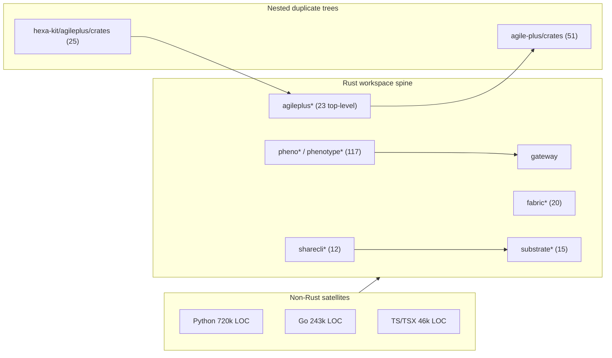

## Architecture graph

## Reading order for a newcomer

1. `Cargo.toml` — real `[workspace]` with an explicit `members` list; the only honest index of the spine.
2. `crates/` top level — 372 dirs; a platform surface, ~87% under 2.5k LOC.
3. `crates/gateway/` — one of four mega crates; entry surface for most runtime paths.
4. `crates/agile-plus/` — nested workspace of 51; read before any top-level `agileplus-*`.
5. `crates/hexa-kit/` — holds the third agileplus copy; explains apparent LOC duplication.
6. `crates/agileplus-cli/` — smallest honest entry into AgilePlus behaviour.
7. `crates/sharecli/` + `sharecli-*` — 90k LOC family; second-largest product surface.
8. `crates/phenotype-plugins/` — plugin contract; how the pheno* family composes.
9. `absorption/` — 4,414 files of absorbed products; provenance before trusting a crate.
10. `docs/absorbed-from-*` — per-product absorption docs, read with `ABSORPTION_MANIFEST.md`.

## Navigation cheat sheet

| If you want X | Go to Y |
|---|---|
| Workspace member list | `Cargo.toml` (`members = [`) |
| All binary targets | `grep -r '\[\[bin\]\]' --include=Cargo.toml` |
| Gateway/runtime entry | `crates/gateway/` |
| AgilePlus domain logic | `crates/agileplus-domain/` |
| AgilePlus CLI verbs | `crates/agileplus-subcmds/` |
| AgilePlus nested workspace | `crates/agile-plus/crates/` |
| Third agileplus copy | `crates/hexa-kit/agileplus/crates/` |
| ShareCLI session/fleet code | `crates/sharecli-session/`, `sharecli-fleet/` |
| Fabric graph/daemon | `crates/fabric-graph/`, `fabric-daemon/` |
| Plugin contracts | `crates/phenotype-plugins/` |
| Absorbed product history | `absorption/`, `docs/absorbed-from-*` |
| Vendored third-party (exclude from metrics) | `.vendor/lancedb` |

## Confidence and gaps
- **MEASURED** — 42,225 tracked files; Rust 304,248 LOC; Python 720,862; Go 243,250; 372 crate dirs; 154 `[[bin]]`; 10,532 markdown; HEAD `ad667428b` on `layer/governance-happy-path-claims`.
- **MEASURED** — three agileplus copies (23 / 51 / 25 crate dirs) at `crates/`, `crates/agile-plus/crates/`, `crates/hexa-kit/agileplus/crates/`.
- **INFERRED** — per-crate LOC tiers are `find` upper bounds (untracked + nested double-count); top-45 ~677k is ~2.2x tracked total. "Platform surface, not services" rests on the <2.5k long tail, not runtime topology.
- **UNKNOWN** — real crate dependency edges (graph groups by name prefix); which agileplus copy is canonical (no ADR); and the 1 unexamined modified working-tree path.
