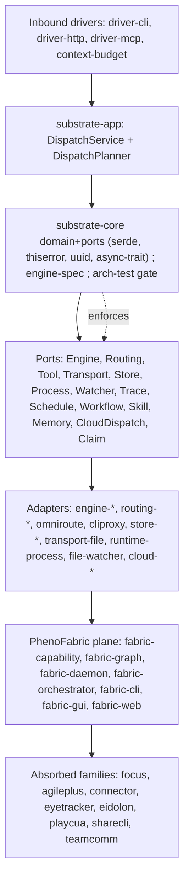

## Capability map
README counts vs measured counts group differently (last-hyphen basis), so they are not comparable (R-02). No build was run: binary-level maturity is UNKNOWN where noted.

### `substrate-*` — core dispatch spine
**Purpose:** one org facade routing a task to the best available coding engine through a deterministic planner over hexagonal ports.
**Crates:** `substrate` (facade; features `app`/`spec`/`a2a`), `substrate-core`, `substrate-app`, `engine-spec`, `arch-test`; drivers `driver-cli`/`-http`/`-argv`/`-mcp`, `context-budget`; engine adapters; routing/store/runtime/workflow (`substrate-trace`, `-schedule`, `-dag`, `-skills`, `-memory`, `-tui`, `-a2a`); cloud dispatch.
**Entry points:** binaries `substrate`, `substrate-http`; library `crates/substrate`.
**Maturity/status:** first two `Cargo.toml` members; `arch-test` fails the build on boundary crossings (`README.md:55-56`); failover ADR-0030 accepted, impl landed 2026-09-06 — UNKNOWN (build not verified).

### `fabric-*` — PhenoFabric execution/data/IO substrate
**Purpose:** capability inventory, topology, route compilation, leases, surface isolation, streaming.
**Crates:** `fabric-capability` (+`-ffi`), `fabric-checker`, `fabric-graph`, `fabric-persist`, `fabric-daemon`, `fabric-orchestrator`, `fabric-cli`, `fabric-workspace`, `fabric-frame-transport`, `fabric-gui` (Tauri v2), `fabric-web` (Leptos WASM), `fabric-tray`, `fabric-tui`, `fabric-terminal`.
**Entry points:** `fabric` binary, `fabric-daemon`, Tauri app, WASM SPA.
**Maturity/status:** absorbed from PhenoFabric at `365a3572` (997 files, 118K lines); ADR-0001/0002/0003/0020/0033/0035; `fabric-gui/src-tauri` excluded from the workspace (GTK/WebKit/libsoup-3.0) — PARTIAL.

### `pheno-*` / `phenotype-*` — shared primitives long tail
**Purpose:** absorbed product-family primitives plus infra and observability tooling.
**Crates:** PhenoRegistry (`phenotype-project-registry`, `phenotype-service-registry`, `phenotype-health`); PhenoInfra (`phenotype-crypto`, `-observability`, `-policy-engine`); PhenoGfx (`phenotype-gfx`, `phenotype-voxel` shim); `pheno-otel`, `fake-forge`, `fake-codex-cloud`.
**Entry points:** library crates only.
**Maturity/status:** absorptions at `f7ab4cdb` (3,848 files, 2.1M lines), `6c9b79ca`, `25c8dde1` — UNKNOWN (no build/test recorded).

### `focus-*` — FocalPoint productivity platform
**Purpose:** a complete productivity platform (FocalPoint) shipped alongside its own language, rules engine, scheduling, coaching, rewards/penalties and plugin SDK.
**Crates:** 43 `crates/focus-*` directories, every one carrying a `Cargo.toml`; 25 are explicit root `members`, the rest arrive as path-deps of those members. Largest: `focus-ffi` (3,437 LOC), `focus-cli` (3,093), `focus-ir` (2,491).
**Entry points:** 7 crates declare `[[bin]]` — `focus-cli`, `focus-mcp-server`, `focus-ffi`, `focus-webhook-server` among them; it is a runnable product, not a library pile.
**Provenance:** one bulk-extraction commit, `19f8e0ebe` (2026-09-16, "extract 53 crates from FocalPoint"). That 53 reconciles as 43 `focus-*` plus 9 `connector-*` (one unaccounted). **No `docs/absorbed-from-FocalPoint` manifest exists**, and `docs/ABSORPTION_INDEX.md` contains no `focalpoint`/`focus-` entry — so this is the largest absorption in the repo with no absorption record.
**Maturity/status:** 43,601 LOC across the 43 crates' `src/` trees (47,037 including tests, benches and examples). Zero core dependency: no `phenotype-*`, `substrate-*` or `fabric-*` crate depends on any `focus-*`; the only inbound edges are the 9 `connector-*` crates from the same extraction. Build/test state UNKNOWN.

### `agileplus-*` — AgilePlus planning and sync
**Purpose:** domain, API, gRPC, sqlite, git, NATS, P2P sync, triage, telemetry.
**Crates:** nested `crates/agile-plus/` workspace plus root `agileplus-*`.
**Entry points:** UNKNOWN.
**Maturity/status:** ADR-005 and ADR-0016 accepted; ADR-012 proposed — PARTIAL (governance accepted, plugin architecture still proposed).

### `connector-*` / `eyetracker-*` / `engine-*` / absorbed runtimes
`connector-*` (9): GitHub/Linear/Notion/Fitbit/Strava/GCal/Readwise integrations — PARTIAL (README prefix table only). `eyetracker-*` (8): camera/cli/core/domain/ffi/inference/math; `eyetracker-cli` implied — PARTIAL (membership only). `engine-*` (7): `EnginePort` adapters plus `engine-conformance` harness-agnosticism proof — PARTIAL. Absorbed runtimes `eidolon-*` (`5f0ffd08`), `playcua-*` (`8fdd395d`), `sharecli*` (ADR-0015), `teamcomm-*`, `pheno-compose-*` (ADR-ECO-021), `pheno-proc-runtime`, `hexa-kit`, `argis-extensions`, `Cmdra` — UNKNOWN. `store-*`/`cloud-*`/`driver-*` backends — UNKNOWN. Non-Rust surfaces (`apps/`, `platform/`, `servers/`, `serving/`) contents — UNKNOWN.

## Architecture
Hexagonal (ports and adapters), enforced by `arch-test`, which fails the build when an edge crosses the domain/adapter boundary the wrong way (`README.md:49-56`). Layers: **domain/core** `substrate-core` (domain + ports; depends only on `serde`, `thiserror`, `uuid`, `async-trait`) → **application** `substrate-app` (`DispatchService`, `DispatchPlanner`) → **ports** (`EnginePort`, `RoutingPort`, `ToolPort`, `TransportPort`, `StorePort`, `ProcessPort`, `WatcherPort`, `TracePort`, `SchedulePort`, `WorkflowPort`, `SkillPort`, `MemoryPort`, `CloudDispatchPort`, `ClaimPort`, `MailboxStore`, `EventStorePort`) → **adapters** (`engine-*`, `routing-*`, `omniroute-adapter`, `cliproxy-adapter`, `store-*`, `transport-file`, `runtime-process`, `file-watcher`, `cloud-*`) → **inbound drivers** (`driver-cli`, `driver-http`, `driver-mcp`) → **facade** `substrate`. A second parallel plane, PhenoFabric, is documented in `docs/architecture/` (api, control-plane, graph-runtime, object-plane, protocols, route-compiler, scheduler, security, state-machines), with ADR-0022 keeping the coordinator off payload and realtime hot paths.

Diagram caveat: `AD --> F` and `F --> AB` are narrative edges (README frames Fabric as the execution/data/I-O substrate), not measured Cargo dependencies; real dependency direction is UNKNOWN.

**Shared-kernel contract:** each crate is independently consumable with no inter-crate dependencies, and the workspace is the canonical location for shared infrastructure so every Phenotype service depends on the same battle-tested primitives rather than reinventing them (`PRD.md:3`). Tension: that no-inter-crate-dependency claim contradicts the actual spine, where `substrate` depends on `substrate-core` and `substrate-app` depends on the core ports (`README.md:57-70`).

