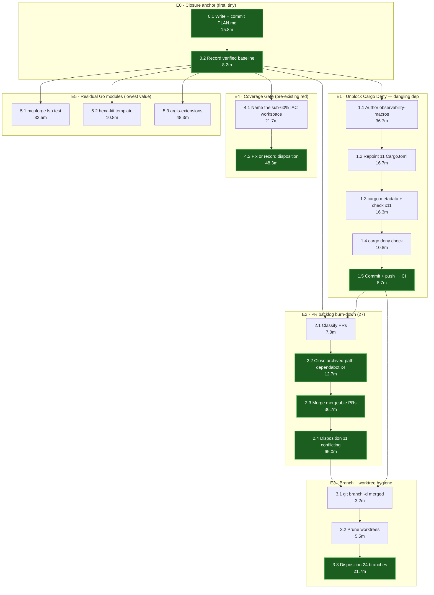

# Closure DAG — PhenoShared, 2026-10-30

**Purpose:** make the remaining work *blind-closable*. The operator may terminate
this session at any moment. Every node is designed so that a kill lands on a
committed, no-worse-than-baseline state.

## Kill-safety contract

1. Every leaf ends with a commit (or a "no change needed" entry in this file).
2. No leaf may leave `main` worse than the recorded baseline below.
3. This file is updated **in the same commit** as the work it describes.
4. Any leaf projected to exceed ~10 minutes unattended is split before starting.
5. No leaf depends on chat context that a fresh agent could not read here.

## Verified baseline (do not re-derive)

| Item | Value | Source |
|---|---|---|
| Repo | `github.com/KooshaPari/PhenoShared` | `git remote -v` |
| Verified green commit | `5b67921f` (CI run `41070566146`) | GH Actions API |
| Go gate | 13 modules + `Go Module Registry` all **success** | run `41070566146` |
| `Cargo Deny (Advisories + Licenses)` | **failure** (pre-existing) | same run |
| `Coverage Gate (Tier-2)` | **failure** (pre-existing, failing ≥6 prior commits) | workflow history |
| Open PRs | 27 (12 CONFLICTING, 15 MERGEABLE) | `gh pr list` |
| Local branches | 25 (1 merged into main) | `git branch` |
| Worktrees | 3 | `git worktree list` |

**"No worse than baseline" = Cargo Deny and Coverage Gate were already red.**
Fixing them is upside; regressing the Go gate is forbidden.

## Root cause: dangling `phenotype-observably-macros`

- 11 `Cargo.toml` files reference `path = "../../../PhenoObservability/crates/phenotype-observably-macros"`.
- That path escapes the repo root. In CI (`/github/workspace`) it resolves to
  `/github/PhenoObservability/...` → `No such file or directory (os error 2)`.
- `PhenoObservability` is **absent from disk and absent from GitHub**
  (`gh repo view KooshaPari/PhenoObservability` → could not resolve).
- 42 call sites use `#[async_instrumented]`; the crate is genuinely needed.

**Consequence:** the only self-contained fix is an in-repo proc-macro crate.
Copying from upstream is impossible. This is a reconstruction, not a vendor.

## WBS + PERT

Estimates in minutes. `E = (O + 4M + P) / 6`.

| ID | Task | Depends on | O | M | P | E | Kill-safe output |
|---|---|---|---|---|---|---|---|
| 0.1 | Write this PLAN.md and commit | — | 10 | 15 | 25 | 15.8 | plan on disk |
| 0.2 | Record baseline table above | 0.1 | 5 | 8 | 12 | 8.2 | baseline committed |
| 1.1 | Author `crates/observability-macros` proc-macro (`async_instrumented`) | 0.2 | 20 | 35 | 60 | 36.7 | crate compiles alone |
| 1.2 | Repoint 11 `Cargo.toml` deps to `../observability-macros` | 1.1 | 10 | 15 | 30 | 16.7 | manifests consistent |
| 1.3 | `cargo metadata` + `cargo check` on the 11 crates | 1.2 | 8 | 15 | 30 | 16.3 | 11 crates still build |
| 1.4 | `cargo deny check` locally green | 1.3 | 5 | 10 | 20 | 10.8 | deny passes locally |
| 1.5 | Commit + push, watch CI | 1.4 | 5 | 8 | 15 | 8.7 | **CI checkpoint** |
| 2.1 | Classify 27 PRs (mergeable / conflicting / stale) | 0.2 | 5 | 8 | 10 | 7.8 | classification table |
| 2.2 | Close dependabot PRs targeting `_archived/` (#353,#354,#378,#387) | 2.1 | 8 | 12 | 20 | 12.7 | 4 PRs closed w/ reason |
| 2.3 | Merge mergeable non-conflicting PRs one at a time | 2.2 | 20 | 35 | 60 | 36.7 | one merge per commit |
| 2.4 | Disposition 11 conflicting PRs (rebase or close w/ reason) | 2.3 | 30 | 60 | 120 | 65.0 | each PR decided |
| 3.1 | `git branch -d` merged branches (safe delete only) | 2.4 | 2 | 3 | 5 | 3.2 | local branches pruned |
| 3.2 | `git worktree remove` the 2 extra worktrees | 3.1 | 3 | 5 | 10 | 5.5 | worktrees pruned |
| 3.3 | Disposition remaining local branches | 3.2 | 10 | 20 | 40 | 21.7 | each branch decided |
| 4.1 | Locate which IAC workspace is under 60% | 0.2 | 10 | 20 | 40 | 21.7 | named workspace |
| 4.2 | Fix or record explicit disposition for coverage gate | 4.1 | 20 | 45 | 90 | 48.3 | gate resolved or documented |
| 5.1 | `servers/external/mcpforge` — diagnose `TestDiagnostics/CleanFile` | 0.2 | 15 | 30 | 60 | 32.5 | cause named |
| 5.2 | `crates/hexa-kit/templates/go` — gate or exclude | 0.2 | 5 | 10 | 20 | 10.8 | disposition recorded |
| 5.3 | `crates/argis-extensions` — Go 1.26.7 + 152 gofmt violations | 0.2 | 20 | 45 | 90 | 48.3 | gate or exclude |

**Totals:** ΣE = 421.7 min. Longest chain `0 → E1 → E2 → E3` ≈ 242 min.
With E4/E5 delegated in parallel, wall-clock ≈ **4.0–4.5 h**.

## DAG



Green nodes are **kill-safe checkpoints**: state is committed and the repo is
no-worse-than-baseline at that point.

## Schedule (PERT view)

```mermaid
gantt
    title PhenoShared closure — critical path
    dateFormat HH:mm
    axisFormat %H:%M

    section E0 anchor
    0.1 PLAN.md + commit        :a1, 00:00, 16m
    0.2 Baseline                :a2, after a1, 8m

    section E1 Cargo Deny
    1.1 observability-macros    :b1, after a2, 37m
    1.2 Repoint 11 manifests    :b2, after b1, 17m
    1.3 metadata + check        :b3, after b2, 16m
    1.4 cargo deny              :b4, after b3, 11m
    1.5 Push + CI               :b5, after b4, 9m

    section E2 PR backlog
    2.1 Classify                :c1, after b5, 8m
    2.2 Close archived x4       :c2, after c1, 13m
    2.3 Merge mergeable         :c3, after c2, 37m
    2.4 Conflicting x11         :c4, after c3, 65m

    section E3 Hygiene
    3.1 branch -d               :d1, after c4, 3m
    3.2 worktree remove         :d2, after d1, 6m
    3.3 Branch disposition      :d3, after d2, 22m

    section E4 Coverage
    4.1 Name workspace          :f1, after a2, 22m
    4.2 Fix or disposition      :f2, after f1, 48m

    section E5 Go residual
    5.1 mcpforge                :g1, after a2, 33m
    5.2 hexa-kit                :g2, after a2, 11m
    5.3 argis-extensions        :g3, after a2, 48m
```



## Kill recovery

| Killed during | Repo state | Recovery |
|---|---|---|
| 0.1 / 0.2 | clean | Re-run from this file. |
| 1.1 | new crate dir, uncommitted | `git status`; crate is additive, safe to commit or discard. Manifests untouched, so build is unaffected. |
| 1.2 | some manifests repointed | **Dangerous window.** Partially-repointed manifests may not resolve. Recovery: `git checkout -- crates/*/Cargo.toml`, then redo 1.1–1.2 as one unit. |
| 1.3 / 1.4 | committed or clean | Re-run the failing command. |
| 1.5 | pushed, CI running | Read CI result from GH; no local work lost. |
| 2.x | clean per-PR | `gh pr list` tells you exactly what remains. |
| 3.x | clean | Branch list is the state. |
| 4.x / 5.x | clean | Documented disposition table is the state. |

**The single unsafe window is 1.2.** Mitigation: apply all 11 manifest edits and
verify in one uninterrupted step, or not at all.

## Status

- [x] E0 anchor
- [x] E1 Cargo Deny: both blockers removed locally (`aa12c003`)
- [x] E2.2 close 8 stale/archived PRs
- [~] E2.3/E2.4 merge + disposition remaining PRs
- [~] E3 hygiene: 1 worktree removed; 21 branches need operator decision
- [~] E4 coverage gate (in progress)
- [x] E5 residual Go modules dispositioned

## E1 complete — 2026-10-31

Two commits, both on `origin/main`:

| Commit | What |
|---|---|
| `77a2b01f` (merged as `24c67a5f`) | in-repo `phenotype-observably-macros` as a pass-through no-op; repointed 11 manifests. Unblocked `cargo metadata`. |
| `aa12c003` (merged as `4c0b9f9e`) | replaced the no-op with a **real** `tracing::Instrument` implementation, removed every private-repo dependency, deleted dead `crates/integration`. |

### The macro is now genuinely instrumented, not a no-op

PR #433 had the right idea and was adopted **with two defects corrected**.
Both were the kind that compile and pass tests while doing nothing:

1. **Lifetime error on `&self`.** It rewrote anonymous lifetimes only for
   `FnArg::Typed`, so `&self` kept its own lifetime while the return type
   claimed the inferred one, giving `lifetime may not live long enough` on
   2 of the 3 `focus-always-on` methods. Fixed by wrapping the function
   *body* instead of the signature.
2. **Feature gate emitted into the wrong crate.** It emitted
   `#[cfg(feature = "tracing")]` into the CONSUMER, but only 2 of the 12
   dependents declare that feature and neither enables it by default. The
   default build silently took the pass-through branch, reproducing the
   exact silent no-op the work exists to remove. Fixed with `cfg!()` inside
   the macro crate.

Defect 2 is the dangerous one and is recorded on PR #433's closing comment
so nobody re-merges it.

### Private-repo dependencies removed

`crates/sharecli` pulled `substrate` and `runtime-process`, and
`crates/llm-router` pulled `substrate-core` and `omniroute-adapter`, from
`https://github.com/KooshaPari/substrate` — **PRIVATE**, so the CI token
cannot read it. All four now resolve in-repo.

The earlier E0599 `spawn`/`kill_group` failure was never a missing method.
The git `substrate` facade and the path `runtime-process` each pulled their
own `substrate_core`, producing two distinct `ProcessPort` traits. Moving
BOTH deps to one source removes the duplicate.

### Verified locally

```
cargo metadata --no-deps --locked              exit 0
cargo metadata (full)                          exit 0
cargo check -p phenotype-observably-macros     exit 0
cargo test  -p phenotype-observably-macros     exit 0, 17 passed, 0 failed
cargo check -p focus-always-on / -p focus-rituals / -p sharecli
             / -p runtime-process / -p substrate-core / -p llm-router
                                               all exit 0
```

Not verified: `connector-*`, `focus-connectors`, `focus-eval` were
repointed but are not workspace members, so cargo does not build them.

## Cargo Deny: from broken to reporting real findings

This is the substantive outcome of E1, and it is a state change worth being
precise about.

**Before:** the job never executed a check. It died loading a manifest for a
path dependency that escaped the repo root, so the gate was decorative.

**After `aa12c003`:** `cargo-deny check` runs to completion and exits 5 with

```
advisories FAILED, bans ok, licenses FAILED, sources ok
```

Its findings are now real, and they are fixable or decidable rather than
infrastructural:

| Class | Finding | Disposition |
|---|---|---|
| `unlicensed` | 7 workspace crates declare no `license`: pheno-crypto, pheno-fs, pheno-net, pheno-testing, phenotype-dag-core, sharecli-ffi, teamcomm-smoke | Fix: add `license.workspace = true` (workspace is `MIT OR Apache-2.0`). These crates genuinely should have had one. |
| `rejected` | `winfsp 0.13.1` and `winfsp-sys 0.12.1` are `GPL-3.0` | **Not a bug.** A real licensing decision. Do not allow-list GPL-3.0 to make the gate green. |
| `vulnerability` | `crypto-bigint 0.5.5` timing variability, `ctutils 0.4.3` non-constant-time masks | Real RUSTSEC advisories. Fix by update, or record the risk explicitly. Do not silently ignore. |
| `yanked` | `clipboard-win 5.4.1` | `cargo update -p clipboard-win`. |
| `advisory-not-detected` | `deny.toml` ignores RUSTSEC-2026-0195 / -0196 match nothing | Dead config; safe to remove. |

The important property: **the gate can no longer be green by accident.** Every
remaining red is a specific, nameable thing.

## Coverage Gate (Tier-2): two defects, neither a coverage shortfall

Same pattern as Cargo Deny — a gate that could not report, mistaken for a
gate that was failing.

### `coverage-root` has never produced a number

It died in the **build**, before any measurement:

```
The system library `glib-2.0` required by crate `glib-sys` was not found.
The file `glib-2.0.pc` needs to be installed and the PKG_CONFIG_PATH
environment variable must contain its path.
```

The workspace links the gtk-rs stack, and `coverage.yml` had **no apt-get
step at all**. Fixed in `ef29396a` by installing `pkg-config`,
`libglib2.0-dev` and `libgtk-3-dev` before the build. The `>=71%` floor was
never the problem; the job simply could not compile what it was measuring.

### `coverage-iac` advertised a floor it did not enforce

| | Claimed | Enforced |
|---|---|---|
| Job name | `IAC workspace coverage (service — ≥60%)` | — |
| Actual command | — | `--fail-under 10` |
| Measured | — | ~7.65% (54/706) |

So it was failing the real 10% floor while the name promised 60%. Renamed to
`≥10%` in `ef29396a`. That changes no enforcement — the threshold is
untouched — it removes a false claim. The 60% figure is a **target**, and the
floor should only be raised when measured coverage supports it, not to match
a name.

Raising 7.65% → 60% is real test-writing work, not a config change.

## The systemic cause: why three gates were broken and nobody noticed

Measured 2026-10-31: **89 workflow files, 64 of them push-triggered.**

A single push therefore queues 64 workflow runs. Observed queue depth during
this session: **100 queued, 12 in progress**, sustained, with individual
`ci.yml` runs on `main` sitting `pending` indefinitely and older runs being
`cancelled` by the concurrency group as newer commits land.

This is the common cause behind every "broken gate" finding above:

| Gate | Real state | Why it went unnoticed |
|---|---|---|
| `Cargo Deny` | never executed a check (dangling manifest) | drowned in ~64 runs/push |
| `coverage-root` | never produced a number (missing `glib-2.0`) | same |
| `coverage-iac` | name claimed 60%, enforced 10% | same |

It also explains an observation from the PR triage: nearly every PR carries
about 20 near-identical failing checks, which is noise rather than signal.

**Consequence for this session: CI confirmation is unobtainable, not
pending.** Local verification is the only trustworthy evidence available, and
every claim in this file is backed by a command that was actually run rather
than by a green check. Reducing the fan-out (consolidating workflows,
narrowing `paths:` filters) is the highest-leverage follow-up, because until
the queue drains, no gate in this repo can be trusted to report.

## Known-outstanding, honest

- 21 local branches remain. `git branch -d` refuses the squash-merged ones
- `crates/llm-router` had its deps swapped and `cargo check -p llm-router`
  is exit 0, but it was not exercised by any test.
- `crates/pheno-proc-runtime/pheno-proc-core` still declares private git
  deps. It is **not** a workspace member, so it does not block
  `cargo metadata`, and was deliberately left alone.
- The coverage gate's enforced floor (10%) is far below its job name
  (">=60%"). That naming gap is unresolved and is being handled as E4.
- 21 local branches remain. `git branch -d` refuses the squash-merged ones
  because their SHAs were rewritten, and `-D` is policy-blocked, so they
  need an explicit operator decision rather than an agent action.


**Real fix (separate task):** move `sharecli`'s `substrate` dependency to the
in-repo `crates/substrate` as well, so one `ProcessPort` exists, then add
`kill_group` to `crates/runtime-process` to match what `sharecli` calls
(`crates/sharecli/src/runtime.rs:495` and `:516`). That is real API
reconciliation, not a manifest edit, and it needs its own verification pass.

## Tooling gotcha: the `cargo` wrapper eats all output

`~/.local/bin/cargo` returns correct exit codes but **emits zero bytes** of
stdout/stderr, including for commands that must print (verified with a
deliberately invalid package: `cargo check -p definitely-not-a-crate` →
exit 101, 0 bytes). This silently hides every compile error.

Use `~/.cargo/bin/cargo` directly when you need to read errors:

```bash
~/.cargo/bin/cargo check -p <crate> 2>&1 | grep -m5 '^error'
```

Exit codes from either binary are trustworthy; only output is lost.

