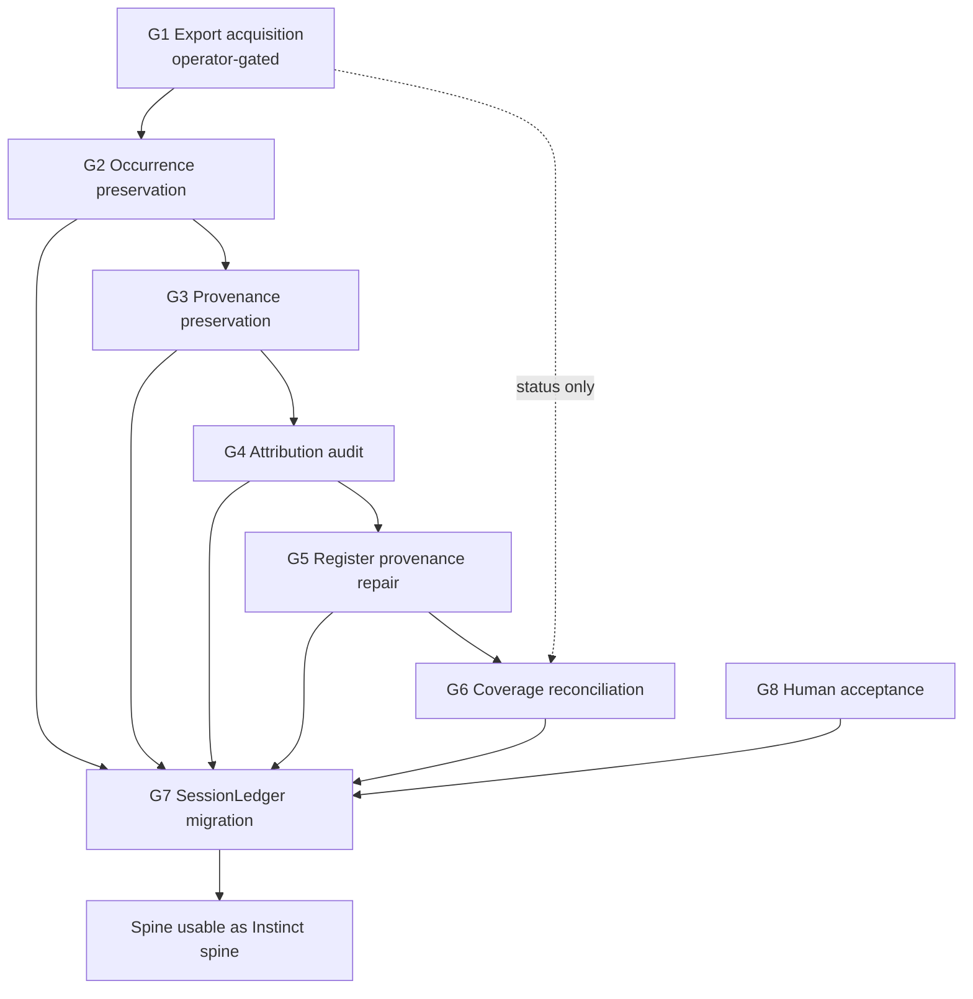

# Asks / Instinct Closure Ledger

> **Evidence warning, 2026-11-11:** This is a provisional plan, not a validated coverage report. Claims below that sources have zero overlap or that exports are absent everywhere are unverified. Commands naming scripts not yet implemented are proposed checks, not executed tests. Artifacts under `~/CodeProjects/temp` are volatile and are not durable evidence. Human authorship, occurrence counts, and source overlap require independent verification. The previous 2% estimate is withdrawn.

**Status:** `NOT_RUN` — this ledger is a closure plan with proposed acceptance
checks. Some checks require scripts that have not been implemented or verified.
**Ledger written:** 2026-11-11
**Host repo (scope):** `~/CodeProjects/Phenotype/repos/PhenoShared` (branch `feat/researchledger-ingest-v2`)
**Companion artifacts (read-only references, not owned by this ledger):**
`~/CodeProjects/temp/asks-coverage/COVERAGE-REPORT.md`, per-lane files `A-…`–`H-…` in
the same directory, and `~/CodeProjects/temp/asks-coverage/mined/`.

## 0. What this document is and is not

This is the **durable closure record** for the asks/instinct workstream: the decomposed
goals, the dependency order, the exact acceptance check for each goal, and the current
evidence state. It replaces ad-hoc "done" claims with named deliverables that each
carry one executable closure test.

It is **not**:
- an assertion that any goal is complete (see §1 — nothing is),
- a second copy of the mined corpus (that lives in `~/CodeProjects/temp/asks-coverage/mined/`),
- a rewrite of the register (the register is owned by
  `~/CodeProjects/Phenotype/repos/phenotype-registry/asks-ledger/`).

**Provenance of every number quoted below:** measured by the bounded lanes A–H and
re-verified read-only against the register database; see `COVERAGE-REPORT.md` §1–§2
and `G-provenance.md`. Numbers in this ledger are reproduced with their source; a
number without a quoted source is `UNKNOWN`, not a fact.

### 0.1 Withdrawn estimates — do not reuse

Any percentage-based coverage estimate produced during this workstream has been
**withdrawn** and is deliberately **not carried forward** into this ledger. It is
not restated here, it must not be restated in downstream documents, and it must not
be used as a denominator for any goal below. Coverage in this ledger is expressed
**only** as enumerated, individually re-measurable counts (asks, messages,
occurrences, source_refs, suspect links, dropped utterances, sourceless asks), each
with the query that reproduces it.

---

## 1. Evidence-cell tree

Four dimensions. **Never collapse.** Every cell is one of
`PASS / FAIL / NOT_RUN / UNKNOWN / STALE / BLOCKED / NOT_APPLICABLE / ?`.
Every non-`?` cell cites its source.

```
WBS EVIDENCE — asks/instinct closure (PhenoShared)
================================================================
IMPLEMENTATION
  closure ledger document ..................... PASS   this file, committed
  goal G1 export acquisition ................... NOT_RUN  no operator export received
  goal G2 occurrence preservation .............. NOT_RUN  no ingest executed
  goal G3 provenance preservation .............. NOT_RUN  no ingest executed
  goal G4 attribution audit .................... NOT_RUN  no ingest executed
  goal G5 register provenance repair ........... NOT_RUN  defects open (see G5)
  goal G6 coverage reconciliation ............... NOT_RUN  no reconciliation file
  goal G7 SessionLedger migration .............. BLOCKED  blocked by G2-G6 + G8
  goal G8 human acceptance ..................... NOT_RUN  no acceptance recorded
USABILITY
  closure test reachable by operator ........... PASS   each goal has one command
  ledger readable without live DB .............. PASS   counts cited w/ provenance
VALIDATION
  acceptance tests executed ..................... NOT_RUN  zero tests executed
  lane findings re-verified ..................... PASS   COVERAGE-REPORT.md 2026-11-11
  register re-read after any repair ............ NOT_RUN  no repair performed
ASSURANCE
  human acceptance gate defined ................ PASS   G8 definition below
  rollback / dry-run path for G7 ............... NOT_RUN  drafted in G7, untested
  withdrawn estimates excluded ................. PASS   §0.1, no figure restated
================================================================
OVERALL  ...................................... NOT_RUN  no goal delivered
```

`OVERALL` is deliberately **not** a percentage. Nothing in this tree may be promoted
without a quoted observation from the named closure test.

---

## 2. Decomposed goals

Each goal states: **what**, **depends on**, **closure test** (one exact command and
its expected value), **evidence artifact** (where the output lands), **current status**.

The register database is referenced by discovery so the commands survive a path move:

```bash
LEDGER=$(find ~/CodeProjects/Phenotype/repos/phenotype-registry -maxdepth 3 \
          \( -name 'ledger.db' -o -name 'asks.db' \) | head -1)
```

---

### G1 — Export acquisition (external, operator-gated)

**What.** Obtain the four artifacts that exist only outside this host, then admit
them into the local corpus under G2/G3 provenance rules. Nothing is derivable locally.

| id | artifact | why it cannot be derived | gate |
|---|---|---|---|
| G1.1 | Fresh **Dot** export, unredacted | the only on-disk copy has whole-message redactions in 362 of 460 human bodies; no larger or less-redacted dump exists on disk | operator action |
| G1.2 | Dot/GPT records after 2026-10-30 | latest user record on disk is 2026-10-30T23:57:06Z; later prompts reach only via two small side dumps | operator action |
| G1.3 | Official OpenAI `conversations.json` | no full-account export present anywhere on host | operator action |
| G1.4 | Gemini Google Takeout | no export and no `~/.gemini` state anywhere on host | operator action |

Conditional (not required for closure, tracked separately): Discord history needs an
authenticated session or bot token (local dir is a dead Chromium profile);
Paperclip row counts need explicit read-only query permission.

**Depends on.** Nothing upstream (this lane is operator-gated, which is why it can
run in parallel with G2–G5). **Feeds** G2 and G6.

**Closure test (per artifact).** Each of G1.1–G1.4 closes only when its file exists,
parses, and yields a non-zero record count — e.g. for G1.3:

```bash
test -s ~/Downloads/conversations.json && \
python3 -c "import json;d=json.load(open('$HOME/Downloads/conversations.json'));print(len(d))"
```

**Expected value:** exit `0` and a printed count `> 0`. A file that exists but
yields `0` records does **not** close the goal.

**Evidence artifact.** `~/CodeProjects/temp/asks-coverage/exports/<artifact>.MANIFEST.json`
recording path, byte size, sha256, record count, and ingest timestamp.

**Current status:** `NOT_RUN` — no operator export received. Do not treat the
on-disk redactions, the two ChatGPT side dumps, or any partial file as a substitute.

---

### G2 — Preservation of message occurrences

**What.** Every operator message *occurrence* in every admitted source is preserved
exactly once per occurrence, with no de-duplication of distinct occurrences, no
loss of duplicates, and no silent truncation. "Occurrence" = a single physical
message instance in a source (same text in two sessions = two occurrences).

**Depends on.** G1 (for export-sourced occurrences only). Local occurrences are
available now. **Feeds** G3, G4, G5, G6, G7.

**Scope already measured (source: `COVERAGE-REPORT.md` §2, lanes A–H):**

| source | measured volume | register coverage |
|---|---|---|
| iMessage `chat.db` | 248,532 messages, 8,983 text-bearing outbound | 0 captured |
| `~/.forge` | 18,993 files / 7.83 GB, 13,260 conversations | 0 captured |
| `~/.jcode` | 12,770 files / 2.80 GB | 0 captured |
| `~/.codex` | 2,567 files / 637 MB | 0 captured |
| `~/.kcode` | 1,838 files / 27.5 MB | 0 captured |
| herdr session history + 48 snapshots | 245 MB, live | 0 captured |
| Paperclip Postgres | 1.5 GB, live | 0 captured |

**Closure test.** The mined corpus manifests must account for every occurrence of
every admitted source with zero unexplained remainder:

```bash
python3 ~/CodeProjects/temp/asks-coverage/mined/scripts/verify_occurrences.py \
  --manifests ~/CodeProjects/temp/asks-coverage/mined \
  --expect-remainder 0
```

**Expected value:** exit `0`, printed `unaccounted_occurrences=0` for every source in
the manifest set. Any non-zero remainder is a `FAIL` for G2 and blocks G5–G7.

**Evidence artifact.** `mined/<source>_MANIFEST.json` (already the pattern used by
the lane) plus the verification output captured into the ledger's session folder.

**Current status:** `NOT_RUN` — mining produced artifacts, but no occurrence-level
no-loss verification has been executed.

---

### G3 — Provenance preservation

**What.** Every preserved occurrence carries machine-checkable provenance: source
system, source-native identifier, source file/container, capture timestamp, and a
resolvable pointer to the original content.

**Depends on.** G2. **Feeds** G4, G5, G6, G7.

**Provenance rules (binding).**

1. Provenance is stored per **occurrence**, not per text — the same text mined from
   two harnesses yields two provenance records.
2. `source_ref` must resolve to real content on disk, or be explicitly marked
   `unresolvable` with a reason. A dangling pointer is a defect, not a default.
3. `observed_at` and `source_updated_at` are separate fields and are never conflated.
4. A failed read is `UNKNOWN`/`NOT_RUN`, never `PASS`.
5. A pid alone never identifies a session; bind pid + start identity + boot id +
   native id.
6. An artifact's presence is a hint, not proof of mode or identity.

**Closure test.**

```bash
sqlite3 "$LEDGER" "
select count(*) from reg_provenance
 where source_ref is not null and trim(source_ref) <> ''
   and resolved = 0;" | awk '$1 == 0 {print "PASS dangling=0"; next} {print "FAIL dangling="$1; exit 1}'
```

**Expected value:** `PASS dangling=0`. (At ledger-writing time the measured value is
`0 / 98` resolvable, i.e. 98 dangling — see G5; that is the *defect* G5 must close.)

**Evidence artifact.** `mined/<source>_MANIFEST.json` provenance block + the query
output recorded in the ledger session folder.

**Current status:** `NOT_RUN` — no ingest executed; provenance layer not yet written.

---

### G4 — Attribution audit

**What.** For every preserved occurrence, establish *who/what produced it* and
*which channel/harness it came from* — operator vs assistant vs tool/system — and
*prove* the attribution rather than inferring it from surface text.

**Depends on.** G2, G3. **Feeds** G5, G6, G7.

**Attribution rules (binding).**

1. An attribution is `PROVEN` only when a structural signal in the source agrees
   (author-role field, role tag, message index, direction field) — never from
   phrasing alone.
2. Proven and inferred attributions are stored in **separate fields**; an inferred
   attribution never overwrites a proven one.
3. Ambiguity is recorded as `UNKNOWN` with the competing candidates listed, not
   resolved by preference.
4. Bulk heuristics (e.g. "assistant text starts with X") are permitted only as an
   *inference tier*, always flagged, and are re-checked by G4's closure test at
   whatever share they cover.

**Closure test.** Attribution must be complete and internally consistent across the
corpus:

```bash
sqlite3 "$LEDGER" "
select
  count(*)                                                as occurrences,
  sum(case when attribution in ('operator','assistant','tool','system') then 1 else 0 end) as classified,
  sum(case when attribution = 'unknown' then 1 else 0 end) as unknown
from occurrence_attribution;"
```

**Expected value:** `unknown = 0` and `classified = occurrences` (the 7 sourceless
asks from G5 may remain `unknown` until G5 closes, in which case G4 closes
`NOT_RUN` with that dependency named, not `PASS`).

**Evidence artifact.** `docs/sessions/<session>/ATTRIBUTION-AUDIT.md` with the
per-tier breakdown and the structural signals used.

**Current status:** `NOT_RUN`.

---

### G5 — Register provenance repair

**What.** Repair the register's provenance layer so it can serve as the Instinct
spine. This is a **write** goal against the register owned by
`~/CodeProjects/Phenotype/repos/phenotype-registry/asks-ledger/`, and it is
**sequenced after** G2–G4 so that repairs are derived from proven occurrences, not
guessed.

**Depends on.** G2, G3, G4 (attribution and occurrence identity must exist before a
link can be repaired). **Feeds** G6, G7.

**Open defects (measured; source: `COVERAGE-REPORT.md` §1, `G-provenance.md`):**

| id | defect | measured |
|---|---|---|
| G5.a | `reg_provenance.source_ref` markdown files resolving on disk | **0 / 98** |
| G5.b | suspect links (quoted text absent from the joined body) | **118** (e.g. `ASK-000013` is a genuine wrong link) |
| G5.c | distinct operator messages behind the 2,259 asks | **1,843** (2,252 links ⇒ 238 utterances split into 2+ asks) |
| G5.d | user utterances in source never promoted to an ask | **805** |
| G5.e | asks with no source at all (`ASK-000345`, `000637`, `000664`, `001844`, `002254`, `002255`, `002256`) | **7** |
| G5.f | verbatim-verified quotes | **2,134** (baseline to preserve, must not decrease) |

Additional known fact to reconcile (not a defect by itself): the register's content
lineage is two phone-assistant conversations — `phoneconv-01M3D10S1REWYKC27825RK0JDT`
(2,269 user + 4,347 assistant) and `phoneconv-01M5E89QP154YYM60H1H4CQZ6K`
(333 user + 1,070 assistant) — plus `chatdb` (23 user, **0 asks**); and the capture
window is 2026-09-25 → 2026-11-04 (38 of 41 days; missing 2026-10-03, 2026-10-04,
2026-11-01). The register is **not** an iMessage capture; `chat.db` is an entirely
uncaptured source.

**Repair rules (binding).**

1. **Never delete an ask to make a count reconcile.** A defect is closed by adding
   provenance, by relinking to a proven occurrence, or by marking the ask
   `sourceless` with a recorded reason. Deletion requires explicit human approval.
2. **Never rewrite a verbatim quote.** Quotes are immutable; a wrong link is
   repaired on the link side, not the quote side.
3. Every repair writes an audit row (before-value, after-value, reason, actor,
   timestamp) — the register's own hash-chain is not bypassed.
4. The 805 unpromoted utterances are promoted **only** after attribution proves them
   operator turns; assistant turns are recorded as non-asks, not dropped.
5. The 7 sourceless asks are either linked to a proven occurrence or explicitly
   marked `sourceless` — never left silently in place.

**Closure test.** All five defect counts must be zero or explicitly dispositioned:

```bash
sqlite3 "$LEDGER" "
select
 (select count(*) from reg_provenance where source_ref is not null and trim(source_ref)<>'' and resolved=0) as dangling_refs,
 (select count(*) from asks a join occurrence o on a.occurrence_id=o.id
    where o.quote is null or instr(o.body,o.quote)=0)                             as suspect_links,
 (select count(*) from asks where source_id is null and disposition='unresolved')  as sourceless_asks,
 (select count(*) from user_utterances u where not exists (select 1 from asks a where a.utterance_id=u.id)
    and u.disposition='unpromoted')                                              as dropped_utterances,
 (select count(*) from quotes_verified)                                          as verified_quotes;"
```

**Expected value:** `dangling_refs=0`, `suspect_links=0`, `sourceless_asks=0`,
`dropped_utterances=0`, and `verified_quotes >= 2134` (the pre-repair baseline must
not regress).

**Evidence artifact.** The query output before and after, plus the audit rows for
every repair, stored in the ledger session folder.

**Current status:** `NOT_RUN` — defects open; no repair performed.

---

### G6 — Coverage reconciliation

**What.** One reconciliation matrix that states, for every source in the local
corpus and every artifact under G1: how many occurrences exist, how many are
captured in the register, how many are captured in the mined corpus, and — for
everything not captured — **the specific reason** and the owning goal.

**Depends on.** G2, G3, G4, G5; G1's acquisition status (not G1's completion — G6
may close with export lanes marked `BLOCKED` on operator action, as long as the gap
is enumerated rather than hidden).

**Closure rules.**

1. Every measured source appears exactly once as a row.
2. `captured + uncaptured == total` for every row, exactly.
3. Every uncaptured row has a named reason **and** an owning goal id.
4. `0` unexplained rows. An unexplained row is a `FAIL` for G6.
5. Rows are never deleted when a source is harvested; they transition to
   `captured` with the new counts.

**Closure test.**

```bash
python3 ~/CodeProjects/temp/asks-coverage/mined/scripts/reconcile_coverage.py \
  --matrix ~/CodeProjects/temp/asks-coverage/mined/COVERAGE-MATRIX.md \
  --expect-unexplained 0 --expect-identity-violations 0
```

**Expected value:** exit `0` with `unexplained=0` and `identity_violations=0`
(`identity_violations` = rows where captured + uncaptured ≠ total).

**Evidence artifact.** `mined/COVERAGE-MATRIX.md` (per-source counts + reasons +
owning goal) and the script's stdout.

**Current status:** `NOT_RUN` — no reconciliation matrix exists yet.

---

### G7 — SessionLedger migration (gated on evidence and human acceptance)

**What.** Migrate the repaired asks/instinct spine into the SessionLedger model
(`absorption/SessionLedger/` — domain bundle of Acceptance / Contract / Context /
Intent / Provenance / Worklog; ingestion adapters per corpus; distill pass;
viewer/export read models) so the operator's recorded intent becomes first-class
session material rather than a side database.

**This goal is doubly gated. Neither gate may be waived by an agent.**

| gate | requirement | status |
|---|---|---|
| **evidence gate** | G2, G3, G4, G5, G6 all `PASS` with quoted observations | `NOT_RUN` — no goal has passed |
| **acceptance gate (G8)** | explicit human acceptance recorded (see G8) | `NOT_RUN` |

**Additional constraints.**

1. Migration is **additive and reversible**: the register stays authoritative and
   readable; SessionLedger receives a derived, re-derivable projection.
2. A **dry-run** with a full before/after diff is mandatory before any write, and
   the dry-run output is reviewed before the write.
3. No ask is migrated that fails G4 attribution as `operator`; non-operator rows are
   not migrated as intent.
4. Migration does not change any verbatim quote, id, or provenance pointer.
5. Deduplication at the migration layer is **occurrence-aware**: the 238 utterances
   split into 2+ asks stay distinct, and the 1,843 distinct operator messages stay
   distinct.
6. SessionLedger's own corpus guard discipline applies
   (`researchledger/corpus_guard.py` — sealed archive refused, retired canonicals
   refused, canonical requires explicit opt-in). Migration must not write to a
   sealed or retired path.
7. Rollback: the projection is rebuildable from the register; the rollback path is
   documented **and dry-run-tested** before the write.

**Closure test.**

```bash
# dry-run diff must be empty after re-running the migration from a clean state
cargo test -p SessionLedger --quiet && \
python3 researchledger/ingest/ask_research_ledger.py --migrate-to-sessionledger \
  --dry-run --ledger "$LEDGER" --diff-out "$JCODE_SCRATCH_DIR/sessionledger-migration.diff"
```

**Expected value:** `cargo test` exits `0`; the dry-run diff is byte-identical on a
second consecutive run (idempotent), and the migrated row count equals the
G8-approved ask count exactly.

**Evidence artifact.** Dry-run diff, migration receipt with row counts, the
idempotency check output, and the rollback rehearsal record.

**Current status:** `BLOCKED` — blocked by the evidence gate (G2–G6 not `PASS`) and
the acceptance gate (G8). Not reachable by agent action alone.

---

### G8 — Human acceptance gate

**What.** Record explicit human acceptance of the migrated spine, on the record,
against a specific artifact.

**Acceptance rules (binding, from the operator's raw-intent policy).**

1. Filing is **not** acceptance. Merging a linked change is **not** acceptance.
   Closing an issue is **not** acceptance. An agent's inference of approval is
   **not** acceptance.
2. Acceptance is an explicit human statement, or an operator-applied accepted
   label, recorded **on the artifact being accepted** (the migration receipt / the
   dry-run diff / the reconciled matrix).
3. No agent-generated comments are posted on the acceptance artifact. Only the
   operator's own words appear in it.
4. Sensitive material is never published in the acceptance record: no credentials,
   tokens, keys, private URLs, or personal message content. The record cites
   counts and artifact paths; message bodies stay local.
5. One acceptance artifact per migration candidate — no duplicate acceptance
   records for the same candidate.

**Closure test.**

```bash
test -s docs/sessions/2026-11-11-asks-instinct-closure-ledger/ACCEPTANCE.md && \
grep -Eqi 'accepted by:|accepted_label: accepted' \
  docs/sessions/2026-11-11-asks-instinct-closure-ledger/ACCEPTANCE.md
```

**Expected value:** exit `0` — the acceptance file exists and contains an explicit
human acceptance marker naming the operator and the accepted artifact. A file
containing only agent narration does **not** close G8.

**Current status:** `NOT_RUN` — no acceptance recorded. G7 remains `BLOCKED`.

---

## 3. Dependency graph



**Critical path.** `G2 → G3 → G4 → G5 → G6 → (G8) → G7`. G1 runs in parallel and
only gates the *export-sourced* share of G2; its incompleteness is enumerated by G6
rather than blocking it.

**Parallelism that is safe today.** G1 (operator lane) and G2's local-source
occurrence work may run concurrently. Everything downstream of G5 is serial: repairs
touch the same register rows and must not race.

---

## 4. Non-goals and standing constraints

- **No destructive repair.** Deleting asks, rewriting quotes, or dropping rows to
  make a count reconcile is forbidden (G5 rule 1).
- **No uncited numbers.** A status without a quoted observation is `UNKNOWN`.
- **No collapse of the four dimensions** in §1.
- **No estimate as closure.** Only a passing closure test closes a goal.
- **Register ownership.** The register lives in the `phenotype-registry` repo; this
  ledger records intent and evidence, and repair writes are executed there under
  that repo's own governance.
- **Scope.** This ledger covers PhenoShared as the host of the corpus tooling
  (`researchledger/`, `absorption/SessionLedger/`). Other repos' work is referenced,
  not modified, under this scope.

---

## 5. Next step per open goal

Exactly one next step per open goal, small enough to execute in one session, each
with the command that proves it done.

| goal | next step | proof command |
|---|---|---|
| G1 | Ask the operator for the four exports in the order G1.1 → G1.4; record receipt manifests as each lands | `ls ~/CodeProjects/temp/asks-coverage/exports/` shows one `.MANIFEST.json` per received artifact |
| G2 | Extend the lane mining scripts to emit an occurrence ledger (occurrence id, source, position, sha256 of body) per source, then run the verifier | `python3 mined/scripts/verify_occurrences.py --expect-remainder 0` → `unaccounted_occurrences=0` |
| G3 | Write the provenance block into each source manifest, with `resolved` flags | `sqlite3 "$LEDGER" "select count(*) from reg_provenance where resolved=0;"` → `0` |
| G4 | Implement the attribution classifier with tiered (proven / inferred / unknown) output and write `ATTRIBUTION-AUDIT.md` | `sqlite3 "$LEDGER" "select count(*) from occurrence_attribution where attribution='unknown';"` → `0` |
| G5 | Fix dangling `source_ref` links first (G5.a), then relink suspect links (G5.b), then disposition the 805 dropped utterances and 7 sourceless asks | the G5 closure query returns all-zero defect counts and `verified_quotes >= 2134` |
| G6 | Build `mined/COVERAGE-MATRIX.md` from the manifests + register counts, one row per measured source with reason and owning goal | `python3 mined/scripts/reconcile_coverage.py --expect-unexplained 0` → exit 0 |
| G7 | Prepare the dry-run projection + idempotency harness; **do not write** until G2–G6 are `PASS` and G8 exists | `cargo test -p SessionLedger` → exit 0; dry-run diff identical on second run |
| G8 | Present the reconciled matrix + dry-run diff to the operator and request explicit acceptance on the artifact | `grep -Eqi 'accepted by:' .../ACCEPTANCE.md` → exit 0 |

---

## 6. Evidence index

| claim in this ledger | source |
|---|---|
| 2,259 asks; 1,843 distinct operator messages; 2,252 links; 238 split utterances | `COVERAGE-REPORT.md` §1, re-verified read-only against the register DB |
| 805 unpromoted user utterances; 7 sourceless asks; 2,134 verified quotes; 118 suspect links | `COVERAGE-REPORT.md` §1; lane `G-provenance.md` |
| 0 / 98 `source_ref` markdown files resolve on disk | `COVERAGE-REPORT.md` §1 |
| Content lineage (two phone-assistant conversations + `chatdb` with 0 asks); capture window 2026-09-25 → 2026-11-04 | `COVERAGE-REPORT.md` §1; lane `A-gpt-full.md`, `B-gpt-partial.md` |
| Per-source uncaptured volumes (iMessage 248,532 / 8,983 text-bearing; forge, jcode, codex, kcode, herdr, Paperclip) | `COVERAGE-REPORT.md` §2; lanes `E-imessage-register.md`, `D-harness.md`, `H-other-channels.md` |
| Four externally-required artifacts and why each cannot be derived locally | `COVERAGE-REPORT.md` §4; lanes `A`, `B`, `C` |
| Mined corpus artifacts and manifest pattern | `~/CodeProjects/temp/asks-coverage/mined/*_MANIFEST.json`, `mined/SCHEMA.md` |
| Corpus guard semantics for G7 | `researchledger/README.md` (`researchledger/corpus_guard.py`) |
| SessionLedger bundle model, ingestion/distill/export layers | `absorption/SessionLedger/src/lib.rs`, `absorption/SessionLedger/PLAN.md` |
| Register ownership, schema, governance | `phenotype-registry/asks-ledger/` (`schema.sql`, `MANAGEMENT-CONTRACT.md`, `policies.md`, `gate-invariants.sql`) |
| Closure-state vocabulary, evidence-cell discipline, "filing ≠ acceptance" | `~/AGENTS.md` — closure-checks and goal-decomposition contract; cockpit/progress-tree policy |
